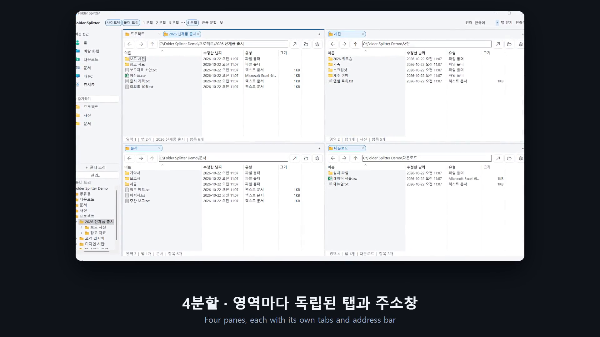

# Folder Splitter

[한국어](README.md) · [English](README.en.md) · [简体中文](README.zh-CN.md) · **日本語**

**1つのウィンドウで最大4つのフォルダーを同時に表示し、各ペインで独立したタブを使える Windows ファイルマネージャー**です。

ファイル一覧には Windows 標準の Shell `IExplorerBrowser` を使用します。既存の `explorer.exe` を変更・置換せず、独立したアプリとして動作します。

## 高速な独自検索

**約372万パスで検索 p95 は62ms。** Everything のインストールなしで、ファイル名・フォルダー名・部分パスから候補を探せます。ファイルを選ぶと親フォルダーでそのファイルが選択されます。

| 応答時間 — 小さいほど高速 | 独自エンジン | 参照 Everything アダプター |
|---|---:|---:|
| 通常の応答 · 中央値（p50） | **21.1ms** | 48.4ms |
| 95% の完了境界（p95） | **62.1ms** | 164.6ms |
| 韓国語の部分パス（p95） | **40.3ms** | 141.5ms |
| 短く、多数に一致する語（p95） | 68.8ms | **7.1ms** |

2026年10月21日、約372万の共通候補、同じ順位・最大100件の結果で37クエリを各エンジン370回測定しました。検索語によって得意不得意があり、Everything 内部のマッチャーだけを比べた表ではありません。初回の索引作成約 **50秒** は、上表の準備後の検索時間とは別です。[測定条件と全結果](docs/search-evidence/benchmark.md)

## 紹介動画

[](docs/media/folder-splitter-intro.mp4)

46 秒、音声なし。すべての画面は、合成サンプルフォルダー（`C:\Folder Splitter Demo`）を開いた実際のアプリです。字幕は韓国語と英語です。画像をクリックすると [MP4 動画](docs/media/folder-splitter-intro.mp4)が開きます。

## 画面


サンプルフォルダーを開いた実際の画面です。各ペインに独立したタブとアドレスバーがあります。未使用のペインは空白のままです。

## 実行

[最新の Windows 実行ファイルをダウンロード](https://github.com/HSoo-Kim/folder-splitter/releases/latest)

Windows 11 x64 用です。リリースの `folder-splitter-win-x64.zip` を展開し、`FolderSplitter.exe` を実行します。.NET ランタイムを同梱しているため、別途インストールする必要はありません。

現在の実行ファイルにはコード署名がありません。Windows が発行元を確認できない旨の警告を表示する場合があります。

## 機能

- **現在のバージョン**：ウィンドウ左下に実行中のバージョンを表示します。サイドバーを非表示にしても表示されます。
- **言語選択**：上部で 한국어 / English / 简体中文 / 日本語を選択できます。選択は次回の起動時にも引き継がれます。Windows 標準のファイル一覧とフォルダー選択画面は OS の表示言語に従います。
- **フォルダーの参照**：アドレスバー横のフォルダーアイコンから選択画面を開きます。各ボタンにマウスを合わせると、選択中の言語で機能の説明が表示されます。
- **1 / 2 / 3 / 4 分割**：上部で切り替えます。非表示にしたペインのタブも保持します。3分割では左右・上下の2対1の配置を選択できます。
- **タブのドラッグで分割**：ファイル一覧の端にドロップすると分割し、中央にドロップするとそのペインへ移動します。最大4ペインです。タブの右クリックメニューからも分割できます。
- **ペインごとの独立したタブ**：新規タブ、複製、閉じたタブの復元、別ペインへの移動に対応します。
- **独立した移動操作**：アドレス入力、パスの自動補完、戻る・進む・親フォルダーへの移動。
- **部分パスの候補**：アドレスバーに `공유용/월별연구계획_20261019` などを2文字以上入力します。現在のフォルダー、開いているタブ、お気に入り、最近閉じたタブを優先します。上下キーと Enter またはクリックで選択でき、ファイルを選ぶと親フォルダーでそのファイルが選択されます。独自の索引を使うため Everything は不要です。
- **分割サイズの調整**：境界線をドラッグするか、均等サイズのボタンで比率を戻します。
- **クイックアクセスとお気に入り**：ホーム、デスクトップ、ダウンロード、ドキュメント、PC、ごみ箱と固定したフォルダーを Windows のアイコン付きで表示します。
- **フォルダーツリー**：左下のツリーがアクティブなペインのフォルダーに追従します。クリックで現在のペイン、中クリックまたは Ctrl+クリックで新しいタブに開きます。右クリックで新しいペインや Windows エクスプローラーでも開けます。サイドバーの「▾ フォルダーツリー」見出し、上部の「フォルダーツリー」ボタン、または `Ctrl+Shift+E` で折りたたみ・展開でき、状態は保存されます。
- **ライト / ダークテーマ**：上部の「ライト」/「ダーク」ボタンで切り替え、選択を保存します。サイドバー、タブ、アドレスバー、ボタン、メニュー、フォルダーツリーに適用されます。各ペインのファイル一覧は Windows Shell が描画するため、Windows のバージョンや設定によっては明るいままの場合があります。
- **項目数**：各ペインの下部にファイル一覧に表示されている項目数を表示し、ファイルの追加・削除ですぐ更新します。
- **Windows 標準のファイル操作**：右クリックメニュー、コピー・切り取り・貼り付け、名前の変更、削除、ペイン間のドラッグ＆ドロップ。
- **表示形式**：各ペインのオプションから詳細、一覧、アイコン表示を選択できます。
- **作業状態の復元**：タブのパス、選択中のタブ、お気に入り、分割方法・比率、ウィンドウサイズ、テーマ、フォルダーツリーの表示状態を保存します。
- **外部エクスプローラーで開く**：ペインのオプションから同じフォルダーを Windows エクスプローラーで開けます。

ファイル一覧の列の並べ替えと右クリックメニューは Windows Shell が処理します。Windows 11 エクスプローラーのコマンドバーや新しいタブ UI 自体を埋め込むものではありません。

## 使い方

1. 上部の4ペイン表示を選びます。
2. 各ペインにパスを入力して Enter を押すか、アドレスバー横のフォルダーアイコンでフォルダーを選びます。
3. ペイン右側の `+` でタブを追加します。
4. タブを右クリックすると、複製・別ペインへの移動・他のタブを閉じる操作ができます。
5. ファイル一覧をクリックして、Windows と同じショートカットを使います。

左側のショートカットは現在のアクティブなペインで開きます。アクティブなペインは上部の青い線で示します。

クイックアクセスの右端を左右にドラッグすると幅を調整できます。サイドバーボタンで全体を非表示・再表示でき、幅と表示状態も保存されます。

新しい分割ペインは空白のままです。アドレスやショートカットからフォルダーを開いてください。最後のタブを閉じても同じフォルダーを自動で開き直しません。既存の保存済みタブは保持します。

お気に入りの見出しをクリックするとリストを折りたためます。初回起動時には Windows エクスプローラーに固定したフォルダーを取り込みます。管理メニューでは、再取り込み・すべて削除・復元リストを利用できます。削除はこのアプリのリストだけに適用され、エクスプローラーの固定項目は変更しません。復元リストには削除した項目と、ごみ箱・PC などの標準の場所が表示されます。

### キーボードショートカット

| キー | 操作 |
|---|---|
| `Ctrl+1`、`Ctrl+2`、`Ctrl+3`、`Ctrl+4` | 分割数を切り替え |
| `F6` | 次のペインへ移動 |
| `Ctrl+T` | 現在のフォルダーを新しいタブで開く |
| `Ctrl+W`、タブの ×、タブを中クリック | タブを閉じる |
| `Ctrl+Shift+T` | 閉じたタブを復元 |
| `Ctrl+Tab`、`Ctrl+Shift+Tab` | 次・前のタブ |
| `Ctrl+L`、`Alt+D` | アドレスバーを選択 |
| `Alt+Left`、`Alt+Right`、`Alt+Up` | 戻る・進む・親フォルダー |
| `Ctrl+D` | 現在のフォルダーをお気に入りに追加 |
| `Ctrl+Shift+E` | フォルダーツリーの表示/非表示 |
| `F5` | 更新 |
| `Ctrl+C`、`Ctrl+X`、`Ctrl+V` | 選択したファイルのコピー・切り取り・貼り付け |
| `F2` | 選択したファイルの名前を変更 |
| `Delete` | 選択した項目を削除：Windows Shell の設定に従う |
| `Ctrl+Shift+N` | 新しいフォルダー |
| `F1` | ショートカットのヘルプ |

## データと互換性

- 設定ファイル：`%LOCALAPPDATA%\QuadExplorer\session.json`
- 旧 QuadExplorer のタブとお気に入りを引き継ぐため、設定の保存先は変更していません。
- 同じ設定ファイルを使うアプリは同時に1つだけ実行してください。
- 1ペインあたり最大32タブ、お気に入りは最大100件です。
- 接続が切れたドライブや存在しないフォルダーではエラーを表示します。アドレスバーから別のフォルダーを選択できます。
- ファイルの削除・上書き・競合処理は Windows Shell に委ねます。アプリ独自の再帰削除は行いません。
- OneDrive/Dropbox の状態表示、外部の Shell 拡張、ネットワーク共有は、各サービスのインストール状態と権限に依存します。
- 使用可能なローカル固定ドライブのファイル・フォルダー名とパスをバックグラウンドで索引化します。内容は読みません。初回は索引の準備状態を表示し、次回からは保存済みの索引を使いながら変更を照合します。
- キャッシュ：`%LOCALAPPDATA%\FolderSplitter\Search\paths.v1.index`。`--session` 指定時は設定ファイルの隣の `.search.index` を使います。アクセスできないパス、ジャンクション・シンボリックリンクの内部は対象外です。ネットワーク・リムーバブルドライブは直接パスで移動できます。
- 既定のエクスプローラーの置換、既存のタブの取り込みには対応していません。[測定結果と制限](docs/search-evidence/benchmark.md)を参照してください。

別の作業セッションやテストには設定ファイルを指定できます。

```powershell
.\FolderSplitter.exe --session C:\Work\folder-session.json C:\Projects D:\Research
```

追加のフォルダー引数はアクティブなペインの新しいタブで開きます。

## ソースからビルド

必要環境：Windows 11 x64、.NET 10 SDK。

```powershell
.\build.ps1                 # Release ビルドと設定の回帰テスト
.\build.ps1 -UiTests        # 実際のネイティブウィンドウによる統合テストも実行
.\build.ps1 -Publish        # ランタイム同梱の実行ファイルと ZIP を生成
```

UI 統合テストは `tools/PrivateDesktopQa` が作成する別の非公開 Windows デスクトップで実行するため、使用中の画面にウィンドウを開いたり、マウスやキーボードを操作したりしません。ログイン済みの Windows セッションが必要です。一時フォルダーのみを使用し、移動完了イベントを待ちます。固定時間の待機には依存しません。

出力：

```text
artifacts/FolderSplitter/FolderSplitter.exe
artifacts/folder-splitter-win-x64.zip
```

公開用のビルドが成功した後、以前のバージョンの生成済み実行ファイルを整理し、ローカルには最新版のみを残します。ソース、設定、利用者のファイルは削除しません。

## 構成

```text
src/FolderSplitter/
  MainForm.cs           ウィンドウ、分割、クイックアクセス、ショートカット
  ExplorerPane.cs       ペインごとのタブとアドレスバー
  ShellViewHost.cs      ネイティブ Shell ビューのライフサイクル
  ShellInterop.cs       Windows SDK COM/PInvoke 宣言
  SessionState.cs       設定の検証とアトミック保存
  Theme.cs              ライト/ダークテーマと角丸の共通コントロール
  FolderTree.cs         左側のフォルダーツリー
  ShellIconCache.cs     クイックアクセスの Windows アイコン
  Assets/               アイコンの PNG 原本と複数解像度の ICO
tests/
  QuadExplorer.Tests/   設定モデルの回帰テスト
  ExplorerFavorites.Tests/ お気に入り取り込みテスト
  QuadExplorer.UiTests/ 実際の Shell ビューによる統合テスト
tools/
  PrivateDesktopQa/     非公開デスクトップ UI テストランチャー
```

アプリのコードは外部の NuGet パッケージに依存しません（UI テストのみ Lib.Harmony を使用）。Windows Shell と .NET Windows Forms を使用します。

アイコンの原本を置き換えた場合は、次のコマンドで Windows 用 ICO を再生成してください。

```powershell
.\tools\Build-Icon.ps1 -SourcePng .\src\FolderSplitter\Assets\app.png
```
