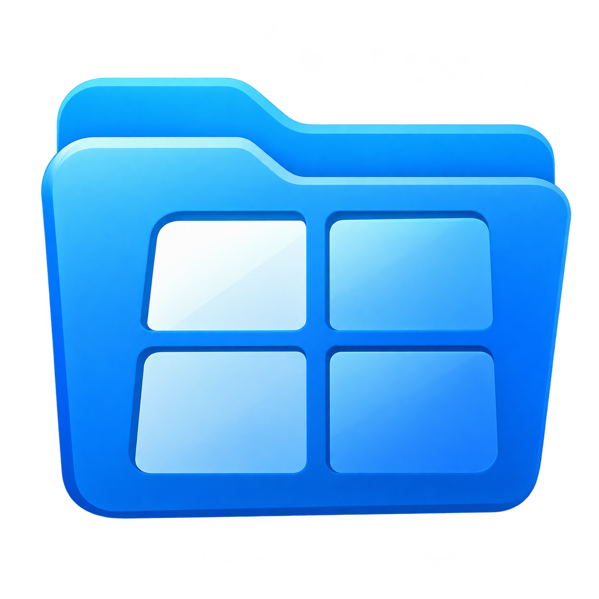
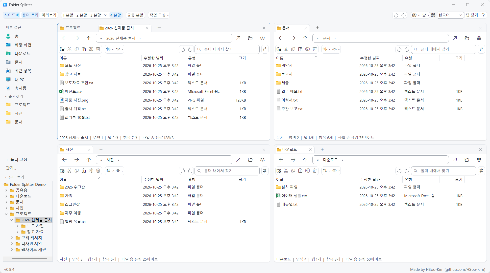
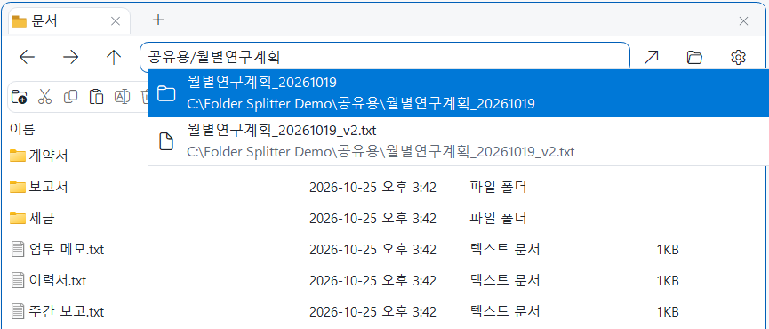
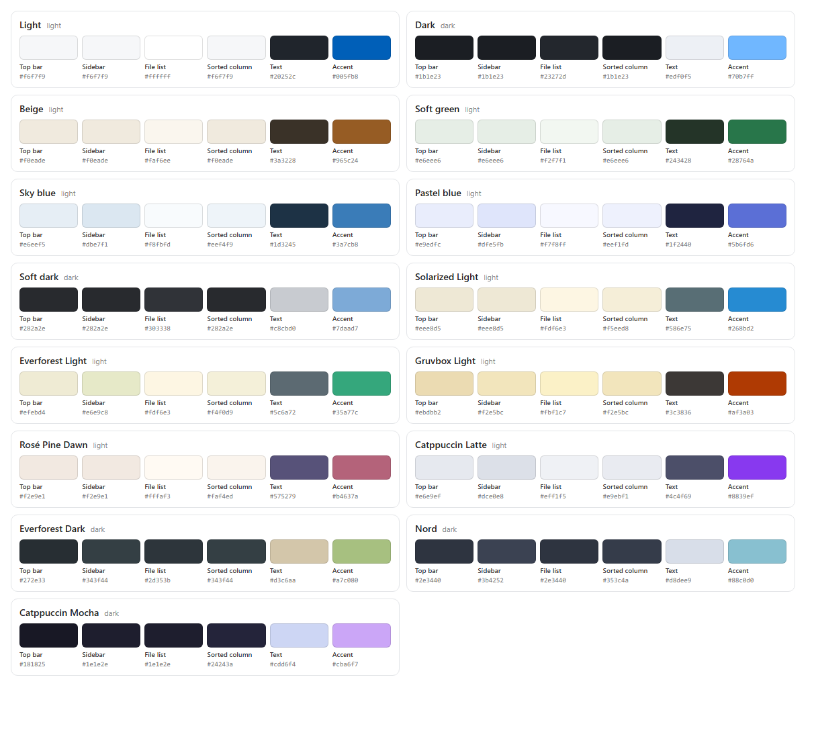

<div align="center">



# Folder Splitter

**한 창에 최대 4개 폴더, 영역마다 독립 탭. 이름 조각만 입력하면 바로 찾습니다.**

<p>
  <a href="https://github.com/HSoo-Kim/folder-splitter/releases/latest/download/folder-splitter-win-x64.zip"></a>
  <a href="https://github.com/HSoo-Kim/folder-splitter/releases/download/mac-v0.1.4/folder-splitter-mac.zip"></a>
  <a href="https://github.com/HSoo-Kim/folder-splitter/releases/latest"></a>
  <a href="https://github.com/HSoo-Kim/folder-splitter/releases"></a>
  <a href="https://github.com/HSoo-Kim/folder-splitter/stargazers"></a>
  <a href="LICENSE"></a>
</p>

<p>
  <a href="README.md">English</a> ·
  <b>한국어</b> ·
  <a href="README.zh-CN.md">简体中文</a> ·
  <a href="README.ja.md">日本語</a>
</p>



</div>

Windows 기본 파일 목록(Shell `IExplorerBrowser`)을 사용하는 Windows 파일 관리자입니다. 기존 `explorer.exe`를 수정하거나 교체하지 않으며, 별도 앱으로 실행됩니다.

## 핵심 기능 (Key Capabilities)

| 기능 | 설명 |
|---|---|
| **빠른 검색** | 주소창에 이름이나 경로 조각만 입력합니다. 앱이 직접 관리하는 인덱스로 약 230만 개 경로에서 보통 10ms 안에 찾으며, Everything 설치도 파일 내용 읽기도 필요 없습니다. [자세히](#주소창이-곧-검색창) |
| **4분할과 영역별 독립 탭** | 원본·대상·참고 폴더를 한 화면에 나란히 둡니다. 폴더를 가운데 클릭이나 `Ctrl+Enter`로 새 탭에 열고, 탭을 다른 영역으로 끌어 옮기거나 가장자리에 놓아 분할합니다. |
| **Chrome식 탭 그룹** | 탭을 최대 12개씩 이름과 색이 있는 그룹으로 묶고, 접거나 사이드바에 저장합니다. 끌던 탭을 그룹 끝에서 0.3초 멈추면 그룹에 들어갑니다. 늘 쓰는 탭은 맨 앞에 고정합니다. |
| **여러 창** | `Ctrl+N`으로 새 창을 엽니다. 탭과 그룹을 다른 창으로 끌어 옮기거나 창 밖에 놓아 새 창으로 떼어 내며, 다음 실행 때 모든 창이 돌아옵니다. |
| **닫은 탭·영역 복원** | `Ctrl+Shift+T`가 마지막으로 닫은 탭이나 분할을 위치·비율까지 복원합니다. 영역별 되돌리기 버튼도 있습니다. |
| **제자리 미리보기** | 이미지와 여러 쪽 PDF를 목록 옆에서 봅니다. 파일을 고정하거나 별도 창으로 띄워 나란히 비교합니다. |
| **폴더 비교와 정리** | 한쪽에만 있는 파일, 더 새 파일, 크기가 다른 파일을 찾아 다른 영역으로 복사·이동합니다. 일괄 이름 변경은 바뀔 이름을 먼저 보여 줍니다. |
| **세션·작업 구성 복원** | 실행하면 탭·그룹과 배치가 복원됩니다. 작업 구성을 이름으로 저장하고, `Win+Alt+E`로 어디서든 불러옵니다. |
| **Windows 기본 동작과 맞춤 화면** | 우클릭 메뉴·끌어 놓기·복사 대화상자는 Windows 방식 그대로입니다. 15가지 테마나 직접 고른 색, 글꼴, 줄 간격, 명령 막대 표시를 고릅니다. |

[전체 기능 안내](#기능)

## 빠른 시작

1. [folder-splitter-win-x64.zip](https://github.com/HSoo-Kim/folder-splitter/releases/latest/download/folder-splitter-win-x64.zip)을 내려받습니다(Windows 11 또는 Windows 10 버전 2004 이상, x64).
2. 압축을 풀고 `FolderSplitter.exe`를 실행합니다. 설치가 필요 없고 .NET 런타임이 들어 있습니다.
3. 영역의 주소창에 이름 조각을 입력하거나 사이드바에서 폴더를 고릅니다.

**Mac:** [folder-splitter-mac.zip](https://github.com/HSoo-Kim/folder-splitter/releases/download/mac-v0.1.4/folder-splitter-mac.zip)을 내려받아(macOS 15 이상, Apple 실리콘·Intel) 압축을 풀고 **Folder Splitter**를 응용 프로그램 폴더로 옮깁니다. 처음 열면 '열지 않음' 경고가 뜹니다. **완료**를 누르고(휴지통으로 이동 아님) 시스템 설정 ▸ 개인정보 보호 및 보안 아래쪽의 **그래도 열기** ▸ 암호 ▸ 다시 **그래도 열기**를 누릅니다. 자세한 내용: [릴리스 노트](https://github.com/HSoo-Kim/folder-splitter/releases/tag/mac-v0.1.4) · [mac/README.ko.md](mac/README.ko.md)

초기 버전은 코드 서명되지 않아 Windows가 게시자를 확인할 수 없다는 안내를 표시할 수 있습니다. 개발과 검사는 Windows 11에서 합니다.

## 주소창이 곧 검색창

경로를 다 기억하지 못해도 됩니다. 주소창에 **기억나는 이름 조각**을 입력하면 입력하는 즉시 맞는 폴더와 파일이 아래에 펼쳐집니다. `공유용/월별연구계획`처럼 폴더와 파일 이름 조각을 `/`로 이어 쓰면 범위가 좁혀집니다.



- **폴더**를 고르면 그 폴더로 이동하고, **파일**을 고르면 파일이 있는 폴더를 열어 그 파일을 바로 선택해 줍니다.
- 검색 결과에는 파일 목록과 같은 아이콘을 표시합니다. 동기화 상태나 문서 보안 자물쇠처럼 다른 프로그램이 아이콘에 붙이는 표시도 함께 나옵니다.
- ↑/↓와 Enter, 또는 클릭으로 고릅니다. 현재 폴더, 열린 탭, 즐겨찾기, 최근 닫은 탭과 가까운 결과가 먼저 나오고, 그다음에 자주 연 폴더(3번 이상) 안의 결과가 옵니다.
- 목록은 가장 알맞은 50개로 시작합니다. 더 있으면 **결과 더 보기**(↓로 마지막 줄까지 내려가 Enter, 또는 클릭)로 최대 200개, 한 번 더 누르면 500개까지 봅니다. 그 뒤에는 이름을 더 입력해 좁히세요.
- 로컬 드라이브를 자체 색인하므로 Everything 같은 별도 프로그램이 필요 없습니다. 파일 내용은 읽지 않습니다.

### 이렇게 찾으세요

예를 들어 `D:\연구\KMA500m_15분_자료공유_20261020\Raw_data_15min_rain\rn_15m_2022_08.nc`를 찾는다면:

| 입력 | 규칙 | 나오는 것 |
|---|---|---|
| `rn 2022_08` | 띄어 쓴 조각이 **모두 이름에** 있으면 찾습니다. | `rn_15m_2022_08.nc` |
| `nc 15m 2022` | 조각의 **순서는 상관없고**, 이름 중간 조각이어도 됩니다. | `rn_15m_2022_08.nc` |
| `.NC 2022_08` | 대소문자를 구분하지 않습니다. | `rn_15m_2022_08.nc` |
| `자료공유` | 폴더도 이름 조각으로 찾습니다. | `KMA500m_15분_자료공유_20261020` 폴더 |
| `15min_rain/rn_15m` | `/`로 이으면 경로를 따라 좁힙니다. 앞 조각은 폴더 이름의 끝, 뒤 조각은 그 안 항목 이름의 앞부분입니다. | `rn_15m_…` 파일들 |
| `"회의 자료"` | 띄어쓰기가 들어간 이름은 따옴표로 묶습니다. | `회의 자료.pptx` 등 |

띄어 쓴 조각은 각 파일·폴더 **자기 이름**에서만 찾습니다. 그래서 `자료공유 nc`처럼 상위 폴더 이름과 파일 이름 조각을 섞으면 나오지 않습니다. 이때는 파일 이름 조각만 쓰거나(`rn nc`), `/`로 경로를 이어 주세요.

### 검색 속도

**경로 약 230만 개에서 보통 10ms, 요청의 95%가 31ms 안에 끝납니다.** (0.7.17, 2026-10-23 측정)

| 검색어 종류 | 보통 응답(p50) | 95% 경계(p95) |
|---|---:|---:|
| 이름 조각 | 9.4ms | 22.2ms |
| 대소문자를 바꾼 이름 조각 | 9.4ms | 22.0ms |
| 부분 경로 (`폴더/이름`) | 11.5ms | 12.7ms |
| 한글 부분 경로 | 16.1ms | 16.5ms |
| 짧고 결과가 아주 많은 검색어 | 32.8ms | 95.3ms |
| 결과가 없는 검색어 | 8.0ms | 8.1ms |
| **전체** | **9.6ms** | **31.0ms** |

C: 드라이브 전체(색인 제외 폴더 적용, 경로 2,298,670개)에서 37개 검색어, 상위 100개 결과, 우선 폴더 6개 조건으로 예열 3회 후 5회(총 185회) 측정했습니다. Ryzen 9 9950X, Windows 11 기준입니다. 처음 색인을 만드는 데 약 26초, 저장된 색인을 불러오는 데 0.25초 걸렸습니다.

**Everything과 비교** (2026-10-21, 이전 엔진, 색인 제외 없이 약 372만 경로): 전체 p95는 Folder Splitter 62.1ms, Everything 연동 164.6ms였고, 짧고 결과가 아주 많은 검색어는 Everything이 더 빨랐습니다(68.8ms 대 7.1ms). 이후 엔진과 색인 범위가 바뀌었으며 Everything 비교는 다시 하지 않았습니다. [측정 조건과 전체 결과](docs/search-evidence/benchmark.md)

### 가볍게 동작

| 항목 | 값 |
|---|---|
| 앱 메모리 (켠 직후, 4분할) | 약 280MB |
| 가만히 있을 때 CPU | 1% 미만 |
| 검색 색인 메모리 | 약 150MB (경로 약 230만 개) |
| 새 파일이 검색에 반영되기까지 | 2~3초 |

자주 바뀌는 시스템 폴더(Windows, `ProgramData`, `AppData` 등)는 색인하지 않고, 변경을 모아서 반영하기 때문에 쉬는 동안 CPU를 거의 쓰지 않습니다. 개발자 PC 기준이며 파일 수에 따라 다르고, 오래 켜 두면 메모리가 다소 늘어날 수 있습니다(이 PC에서 몇 시간 뒤 약 460MB). 0.7.14에서는 같은 PC에서 켠 직후 약 1.2GB였습니다.

## 기능

### 화면 분할과 탭
- **1~4분할**: 상단 버튼이나 `Ctrl+1`~`Ctrl+4`로 바꿉니다. 3분할은 좌우·상하 2:1 배치도 고를 수 있습니다.
- **크기 조절**: 경계선을 끌어 조절하고, `균등 분할`로 되돌립니다.
- **영역별 탭**: 영역마다 탭을 따로 씁니다. `+`나 `Ctrl+T`는 빈 탭을 열어 주소창에 바로 입력하게 하고, 같은 폴더를 하나 더 열려면 탭 우클릭 → `탭 복제`를 씁니다. 닫은 탭 복원도 지원합니다.
- **새 탭 열기**: 폴더를 가운데 클릭하거나 Windows 기본 우클릭 메뉴의 **새 탭에서 열기**, Ctrl+더블클릭, Ctrl+Enter를 쓰면 뒤쪽 새 탭으로 열립니다. Ctrl 조작에 Shift를 더하면 새 탭으로 바로 전환합니다. 사이드바·폴더 트리·경로 단추·주소창 검색 결과도 가운데 클릭이나 Ctrl+클릭으로 새 탭에 엽니다. 관련 탭은 원래 탭 뒤에 열리고, 자리가 있으면 같은 그룹에 들어갑니다. 폴더나 파일을 탭 줄에 놓으면 삽입 표시 위치에 열립니다(파일은 해당 폴더를 열어 선택합니다). 이 동작은 위치를 탭으로 연결할 뿐 원본 항목을 옮기지 않습니다. 끌어 놓는 중 탭 위에 잠시 머물면 그 탭으로 전환한 뒤 Windows 기본 파일 목록에 놓을 수 있습니다.
- **탭 그룹**: 탭을 우클릭해 이름과 색이 있는 그룹을 만들거나 기존 그룹에 넣습니다(그룹당 최대 12개 탭). 새 그룹은 이름 편집기가 바로 열립니다. 그룹 이름 칩을 누르거나 칩에 초점을 둔 상태에서 Enter·Space를 누르면 접거나 펼칩니다. 접은 그룹도 탭 목록에서 고를 수 있고, Ctrl+Tab과 마우스 휠은 숨겨진 탭을 건너뜁니다. 그룹 이름·색·접힘 상태는 세션과 작업 구성을 복원할 때 함께 돌아옵니다. 칩 메뉴에서 이름·색 변경, 그룹 해제·이동·닫기도 합니다. 옮길 수 없는 대상은 도움말에 이유가 나옵니다. 그룹 닫기는 한 번에 되돌리며, 탭·이름·색·선택한 탭을 함께 복원합니다. 탭 하나만 다시 열면 원래 그룹이 남아 있고 자리가 있을 때 그 그룹으로 돌아갑니다.
- **탭 고정**: 탭 메뉴에서 탭 하나나 여러 선택 탭을 고정·해제합니다. 고정 탭은 폴더 아이콘과 너비에 맞춘 이름을 유지하고, 닫기 버튼 대신 이름 뒤에 작은 단색 압정을 표시합니다. 압정을 누르면 고정이 풀립니다. 그룹을 접거나 다른 탭이 넘쳐도 탭 줄 맨 앞에 보입니다. 이름은 먼저 말줄임표로 줄이고, 탭 줄이 아주 좁을 때만 아이콘과 압정만 남깁니다. 이름에 마우스를 올리면 폴더 경로, 압정에 올리면 `탭 고정 해제`가 나옵니다. 고정하면 그룹에서 빠지고, 고정 탭을 그룹에 넣으면 고정이 풀립니다. 맨 앞 고정 구간 안팎으로 끌면 고정·해제되며, 다른 영역이나 창으로 옮겨도 고정은 유지됩니다. Ctrl+W와 가운데 클릭으로는 고정 탭도 닫지만, `다른 탭 닫기`는 고정 탭을 남깁니다. 고정 탭도 영역당 32개 제한에 포함되며, 세션·작업 구성·메모리 정리 재시작 때 복원됩니다.
- **그룹 편집기**: 연한 그룹 색을 입힌 둥근 폴더 칩으로 밝은·어두운·사용자 지정 테마에서도 그룹 색을 구분합니다. 모서리가 둥근 편집기는 이름 칸에 초점을 두고 열리며, 색 9가지 중 고릅니다. `Alt+Shift+C`는 활성 탭의 그룹에 새 탭을 추가하고, `Alt+Shift+W`는 그 그룹을 한 번에 되돌릴 수 있게 닫습니다. 활성 탭에 그룹이 없으면 두 명령 모두 이유를 안내합니다. 저장한 그룹의 편집기에는 `그룹 삭제`도 있습니다. 탭을 한 번에 되돌릴 수 있게 닫으면서 저장본을 지우며, 되돌리기는 탭만 복원하고 지운 저장본은 복원하지 않습니다.
- **그룹 닫기 확인**: 칩 편집기의 `그룹 닫기`와 `Alt+Shift+W`는 탭을 닫기 전에 확인합니다. Enter는 닫기이고, Esc·취소·대화상자 닫기 버튼은 그룹을 그대로 둡니다. 닫은 그룹은 `Ctrl+Shift+T`로 한 번에 복원합니다. `다시 묻지 않기`는 모든 창에 적용되어 세션에 저장되며, 설정 → `그룹 닫기 전에 확인`에서 다시 켭니다. 편집기의 `그룹 삭제`는 되돌리기로 저장본을 복원할 수 없어 항상 확인합니다. 영역·창 닫기, 그룹 이동, 작업 구성 불러오기와 다른 탭 닫기 명령에는 이 확인을 추가하지 않습니다.
- **여러 탭 선택**: Ctrl+클릭으로 활성 영역의 선택에 탭을 넣거나 뺍니다. 보고 있는 탭은 선택된 채로 남습니다. Shift+클릭은 마지막 일반 클릭·Ctrl+클릭한 탭부터 보이는 범위를 선택하며, 접은 그룹은 건너뜁니다. 보고 있지 않은 선택 탭은 안쪽에 은은하게 강조합니다. 일반 클릭, 탭 전환, 탭 줄에서 Esc, 탭 제거로 여러 선택이 풀립니다. 선택한 탭을 우클릭하면 함께 그룹으로 묶거나 풀고, 옮기거나 닫습니다. 복제는 우클릭한 탭 하나에만 적용됩니다. 여러 탭 닫기는 되돌리기·다시 실행 한 단계이며, 가능한 경우 이전 위치와 그룹을 복원합니다. 선택 탭 중 하나를 끌면 선택 전체를 옮기고, 용량이 부족하면 원래 탭을 모두 그대로 둡니다.
- **저장한 그룹**: 그룹 칩 메뉴의 `그룹 저장`을 선택하면 즐겨찾기 아래의 공용 `저장한 그룹` 사이드바에 남습니다. 그룹이 열려 있는 동안 이름·색·탭 순서·각 탭의 폴더 이동이 동기화되고, 그룹을 닫아도 저장본은 남습니다. 저장 항목을 누르면 다른 창에 있더라도 이미 열린 그룹으로 이동하고, 열려 있지 않으면 활성 영역에 자리가 있을 때 그룹 전체를 엽니다. 사이드바 메뉴에서 새 창으로 열기, 이름 변경, 저장본 삭제를 합니다. 저장본만 지우면 열린 그룹은 닫지 않습니다. 최대 30개를 최신순으로 표시합니다. 사라진 폴더는 조용히 빼지 않고 일반 폴더 이동 때와 같은 오류를 표시합니다.
- **탭 너비와 탭 목록**: 탭은 폴더 이름 길이에 맞춰 늘고 줄며, 탭이 하나뿐이면 긴 이름도 더 길게 보여 줍니다. 탭이 많아지면 고르게 줄어들고, 그래도 넘치면 `+` 옆 `▾` 버튼에서 모든 탭을 골라 이동합니다.
- **탭 끌어 놓기**: 탭이나 그룹 칩을 원하는 영역의 탭 줄을 따라 끌면 삽입 표시가 목적지를 보여 줍니다. 그룹 탭 사이 또는 펼친 칩 바로 오른쪽에 탭을 놓으면 그 그룹에 들어갑니다. 그룹 칩은 항상 소속 탭을 함께 옮깁니다. 파일 목록 가장자리에 놓으면 그 방향으로 나뉘고, 다른 영역 가운데에 놓으면 그 영역으로 옮겨집니다. 빈 영역에도 탭과 그룹을 놓을 수 있습니다. Esc로 끌기를 취소합니다.
- **그룹 끝 대기 추가**: 마지막 탭의 오른쪽 절반이나 뒤쪽 간격, 또는 접힌 칩의 오른쪽 절반에서 0.3초 머물면 그룹 마지막에 추가합니다. 접힌 그룹은 그대로 접어 둡니다. 그전에는 그룹 뒤에 놓이며, 칩 왼쪽 절반은 항상 그룹 앞에 놓습니다. 기다리는 동안 삽입 표시가 아래에서 위로 그룹 색으로 차오르며, 같은 위치 안에서 포인터가 조금 흔들려도 기다린 시간은 유지됩니다. 추가할 준비가 되면 그룹 칩과 소속 탭의 밑줄이 강조되고, 삽입 위치에 그룹 색으로 칠한 불투명 탭 자리가 나타나 아래에 있는 탭을 가립니다. 접힌 칩의 개수에는 들어올 탭 수가 `+n`으로 표시됩니다. 끌기 안내 문구에도 추가할 그룹 이름 또는 새 탭으로 열기가 표시됩니다. 폴더·파일 드롭과 다른 영역·창의 탭 및 다중 선택 이동에 같은 규칙을 적용하며, 그룹당 12개 제한은 유지합니다.
- **키보드 탭 조작**: `Ctrl+Shift+F6`으로 활성 영역의 탭 줄에 초점을 둡니다. 방향키로 탭과 그룹 칩 사이를 이동하고, Enter·Space로 탭을 선택하거나 그룹을 접고 펼칩니다. Apps 키나 `Shift+F10`은 초점이 있는 항목 아래에 메뉴를 엽니다. `Ctrl+Shift+PageUp`·`Ctrl+Shift+PageDown`은 현재 탭을 좌우로 옮기며, 그룹 경계를 넘으면 들어가거나 빠집니다. 기존 `F6`·`Shift+F6` 영역 이동은 그대로입니다.
- **관련 탭**: 탭을 복제하면 같은 그룹에서 바로 뒤에 사본을 둡니다. 폴더 열기 조작과 메뉴로 연 탭은 활성 탭의 관련 탭 뒤에 차례로 붙이고, 자리가 있으면 같은 그룹에 넣습니다. 그룹이 가득 차면 그 그룹 바로 뒤에 그룹 없이 엽니다. 고정 탭에서 연 관련 탭은 항상 고정하지 않고 맨 앞 고정 구간 뒤에 엽니다. 외부 폴더·파일을 고정 탭 위에 놓아도 고정 구간 뒤에 넣으며, 끌면서 고정 탭 위에 머물러 그 탭으로 전환하는 동작은 그대로입니다.
- **빈 칸**: 새로 나눈 영역은 비어 있습니다. 주소를 입력하거나 왼쪽 바로가기를 눌러 폴더를 엽니다.
- **사용 중인 창 유지**: 1분할로 바꾸면 활성 영역을 남기고, 탭이 없으면 보이는 영역 중 탭이 있는 쪽을 남깁니다. 숨긴 영역의 탭은 유지됩니다.
- **영역 사이 이동**: `F6`은 다음 영역, `Shift+F6`은 이전 영역으로 이동하며 끝에서 처음으로 이어집니다. `Alt+1`~`Alt+4`는 그 번호의 영역으로 바로 갑니다. 열려 있지 않은 영역이면 상태 표시줄이 알려 줍니다.
- **분할 닫기와 복원**: `Ctrl+W`로 탭을 닫고, 탭이 없는 상태에서 다시 누르면 그 분할을 접습니다. 마지막 영역 하나는 남습니다. `Ctrl+Shift+T`는 닫은 순서의 역순으로 빈 분할의 위치·비율을 복원하고, 다시 누르면 그 탭을 복원합니다. 배치를 새로 선택하면 이전 분할 복원 기록은 초기화됩니다.
- **읽기 쉬운 단축키 도움말**: `?`나 `F1`에서 범주별 이동과 단축키·설명 두 열로 된 도움말을 엽니다. 테마·글꼴 설정을 따르고, 좁은 창에서는 줄바꿈합니다.
- **두 가지 닫기 기록**: 각 영역의 `폴더 내에서 찾기` 칸 옆 둥근 되돌리기·다시 실행 버튼은 그 영역에서 닫은 탭만 되살립니다. 오른쪽 위 `설정` 왼쪽의 한 쌍은 모든 영역에서 닫은 탭과 분할을 다루며 `Ctrl+Shift+T`와 같습니다. 어느 쪽으로 되살려도 같은 항목이 두 번 돌아오지 않습니다. 버튼에 마우스를 올리면 범위와 단축키가 나옵니다.

### 탐색과 검색
- **주소창 검색**: 이름 일부만 입력해도 드라이브 전체에서 바로 찾습니다. [자세히](#주소창이-곧-검색창)
- **이동**: 경로 입력과 자동완성, 뒤로·앞으로·상위 폴더, 마우스 옆 버튼을 지원합니다.
- **경로 단추**: 주소창에 `C: › Users › …`처럼 폴더가 단추로 보입니다. 누르면 그 폴더로 가고, `›`를 누르면 하위 폴더 목록이 나옵니다. 빈 곳을 누르거나 `Ctrl+L`이면 지금처럼 경로를 입력하거나 검색합니다.
- **최근 위치**: 뒤로·앞으로 버튼을 우클릭하면 이 탭에서 다녀온 폴더 목록이 나옵니다.
- **폴더 찾아보기**: 주소창 옆 폴더 아이콘으로 폴더 선택 창을 엽니다.

### 사이드바
- **빠른 접근**: 사용자 폴더, 바탕화면, 다운로드, 문서, 최근 항목, 내 PC, 휴지통. 누르면 활성 영역(위쪽 파란 선)에 열립니다. `최근 항목`은 Windows 파일 탐색기처럼 최근에 연 파일과 폴더를 최신순으로 보여 줍니다. 바로 가기가 아니라 실제 파일이어서 끌어다 놓기·복사·`경로 복사`가 원본 파일을 넘기고, 삭제나 이름 바꾸기도 원본에 적용됩니다. 로컬 드라이브에서 지워진 파일은 나오지 않습니다.
- **즐겨찾기**: `Ctrl+D`로 추가하고 우클릭으로 뺍니다. 처음 실행할 때 탐색기의 고정 폴더를 가져오며, `관리...`에서 다시 가져오기·전체 제거·복원을 합니다. 탐색기 쪽에는 영향이 없습니다.
- **폴더 트리**: 활성 영역의 위치를 따라갑니다. 클릭은 현재 영역, 가운데 클릭·Ctrl+클릭은 새 탭, 우클릭은 새 영역이나 탐색기로 엽니다. `Ctrl+Shift+E`로 접습니다.
- **크기**: 사이드바 폭과 즐겨찾기·트리 높이를 경계선으로 조절하고, `사이드바` 버튼으로 숨깁니다.

### 파일 작업
- **Windows 기본 동작**: 우클릭 메뉴, 복사·잘라내기·붙여넣기, 이름 변경, 삭제, 영역 간 끌어 놓기를 Windows가 그대로 처리합니다.
- **명령 버튼**: 파일 목록 위에 탐색기처럼 `새 폴더`·`잘라내기`·`복사`·`붙여넣기`·`이름 바꾸기`·`삭제`가 있습니다(삭제는 휴지통으로, `Ctrl+Z`로 되돌리기). 버튼에 마우스를 올리면 이름과 단축키가 나옵니다.
- **정렬·보기 메뉴**: 이름·수정한 날짜·유형·크기 순, 오름차순·내림차순으로 정렬하고 유형·날짜별로 묶습니다. `보기`에서 아주 큰 아이콘부터 작은 아이콘, 목록, 자세히, 타일, 내용 중 고르고, 탐색기의 `숨긴 항목 표시`·`파일 확장명 표시`(Windows 전체 설정이라 탐색기에도 똑같이 적용)와 세부 정보 창을 켭니다.
- **폴더 내에서 찾기**: 명령 버튼 줄 오른쪽 `폴더 내에서 찾기` 칸에 입력하면 지금 폴더에서 그 글자가 들어간 이름만 남습니다(여러 단어는 모두 들어간 것만). `Esc`로 지우고, 탭이 다른 폴더로 가면 저절로 풀립니다.
- **일괄 이름 변경**: 항목을 두 개 이상 고르고 `이름 바꾸기`를 누릅니다. 글자 찾아 바꾸기(정규식 가능), `{n}`으로 차례 번호 붙이기를 하고 바뀔 이름을 모두 미리 확인한 뒤 적용합니다. 확장자는 그대로 두고, 이름이 겹치면 막으며, 탐색기에서 `Ctrl+Z` 한 번으로 모두 되돌립니다.
- **세부 정보 창**: `보기` → `세부 정보 창`을 켜면 미리보기 아래에 선택한 항목의 속성이 탐색기처럼 나옵니다. 유형·위치·크기·날짜에 더해 사진은 해상도, 동영상·음악은 길이, 문서는 작성자 등입니다.
- **두 영역 비교**: 명령 버튼 줄의 `⇄`를 누르면 이 폴더와 다른 영역의 폴더를 비교해 한쪽에만 있는 항목, 더 새 파일, 크기가 다른 파일을 보여 줍니다. 버튼 하나로 그 항목들을 각 영역에서 선택해 바로 복사할 수 있습니다.
- **보기**: 영역 옵션에서 자세히·목록·아이콘을 고르거나 같은 폴더를 Windows 파일 탐색기로 엽니다. 분류 방법(그룹화)·정렬·보기 방식은 탐색기처럼 폴더마다 기억합니다.
- **항목 수와 선택 정보**: 영역 아래에 항목 수를 보여 주고, 선택하면 `3개 선택 · 1.2GB`처럼 개수와 파일 크기 합계도 보여 줍니다.
- **미리보기**: 상단 `미리보기` 버튼이나 `Alt+P`로 켜고 파일을 클릭합니다. 켜짐 상태와 칸 너비를 기억합니다.
- **미리보기 고정, 새 창**: 미리보기 위쪽 `고정`을 누르면 다른 파일을 골라도 그 미리보기가 그대로 남습니다. `새 창`을 누르면 그 파일만 보는 미리보기 창이 따로 열려, 여러 개를 나란히 놓고 비교할 수 있습니다(최대 8개, PDF 휠 넘기기도 됩니다).
- **다른 영역으로 복사·이동**: `Ctrl+Alt+C`(복사), `Ctrl+Alt+X`(이동)이나 영역 옵션(⚙)에서 선택 항목을 다른 영역의 폴더로 보냅니다. 다른 영역은 바로 전에 쓰던 영역입니다. 진행 표시, 이름 충돌, 되돌리기(`Ctrl+Z`)는 Windows 탐색기와 같은 Windows 복사 창이 처리합니다.
- **현재 폴더를 다른 영역에서 열기**: `Ctrl+Alt+O`나 영역 옵션(⚙)으로 현재 폴더를 다른 영역에서 열고 그 영역으로 이동합니다. 이미 그 폴더를 보는 탭이 있으면 그 탭을 선택하고, 선택된 탭이 비어 있으면 그 탭을 채우며, 아니면 새 탭을 추가합니다. 영역이 하나뿐이면 먼저 2~4분할을 고르라고 상태 표시줄이 안내합니다.
- **경로 복사, 터미널**: `Ctrl+Shift+C`는 선택 항목의 경로를 탐색기처럼 따옴표로 묶어 복사합니다(선택이 없으면 현재 폴더). 영역 옵션의 `여기서 터미널 열기`는 그 폴더에서 Windows 터미널(없으면 PowerShell)을 엽니다.
  - **PDF 여러 쪽**: 별도 PDF 프로그램 없이 표시합니다. 미리보기 위에서 휠을 내리면 다음 쪽, 올리면 이전 쪽으로 이동합니다. 아래쪽의 쪽 번호와 이전·다음 버튼도 사용할 수 있습니다.
  - **분리 창**: 미리보기 상단의 파일 이름 부분을 끌거나 `분리`를 누르면 별도 창으로 볼 수 있습니다. 본창 오른쪽으로 다시 끌어 놓거나 `다시 붙이기`를 누르면 원래 위치로 돌아오며, 보고 있던 PDF 쪽도 유지됩니다.
  - **다른 형식**: 사진은 Windows 축소 이미지로, Office·텍스트 등은 설치된 탐색기 미리보기 표시기로 보여 줍니다. 문서 위의 휠은 파일 목록이 아닌 표시기로 전달하며, 스크롤·페이지 이동 지원 범위는 표시기에 따릅니다.

### 화면과 설정
- **상단 도구 모음**: `사이드바` 왼쪽 압정으로 전역 도구 모음을 고정합니다. 고정을 해제하면 숨겨지고, 창 제목 표시줄의 빈 곳에 마우스를 약 0.35초 머물면 작업 영역 위에 나타납니다. 압정을 다시 누르거나 `Ctrl+Shift+F11`로 전환하며, 선택은 저장됩니다.
- **색 테마**: 상단 오른쪽 메뉴에서 15가지 중 고릅니다. 기본 `낮`·`밤`, 눈이 편한 `베이지`·`연녹색`·`하늘색`·`파스텔 블루`·`은은한 밤`, 그리고 널리 쓰이는 디자인 팔레트(Solarized, Everforest, Gruvbox, Rosé Pine, Catppuccin, Nord)를 바탕으로 위쪽 막대·사이드바·파일 목록·정렬된 열을 서로 다른 색으로 칠한 조합 8가지가 있습니다.
  
- **사용자 지정 색**: 같은 메뉴 맨 아래 `사용자 지정 색…`에서 배경 색과 강조 색을 차례로 견본이나 원하는 색으로 고르면 어울리는 테마를 만들어 줍니다. 고른 색을 그대로 쓰고, 글자가 잘 보이지 않을 때만 필요한 만큼 조정합니다. 최근에 적용한 조합 6개는 같은 메뉴와 대화상자 맨 위에 남아 다시 고를 수 있습니다.
- **글꼴과 글자 크기**: `설정` → `글꼴과 글자 크기`에서 PC에 설치된 글꼴(맑은 고딕, Pretendard, 나눔고딕 등)과 글자 작게·보통·크게를 고르면 파일 목록까지 함께 바뀝니다.
- **활성 영역 테두리**: 현재 영역을 더 굵은 테두리로 구분합니다. `보기` → `활성 영역 색상`에서 테마 기본 색상·파란색·초록색·황갈색을 고릅니다. 모든 영역에 공통 적용하며 재시작 후에도 유지됩니다.
- **목록 모양**: 각 영역의 `보기` 메뉴는 이 영역에만 적용, 모든 영역에 공통 적용, Windows 공통 설정으로 나뉩니다. 모든 영역 공통으로 명령 막대를 숨기고(찾기는 `Ctrl+F`, 나머지 명령은 영역 옵션에 있습니다), 세로 구분선과 정렬 열 강조를 켜거나 끄고(둘 다 기본 꺼짐), 줄 간격을 `빽빽하게`나 `보통`(기본)으로 고릅니다. `보통`은 줄 사이만 넓히고 아이콘과 글자 크기는 그대로 둡니다.
- **폴더 파일 합계**: 상태 줄에 `이 폴더 파일 18.4 MB`처럼 지금 폴더에 바로 들어 있는 파일의 크기 합계가 나옵니다. 하위 폴더까지 훑지 않고 폴더를 한 번만 읽어서 PC에 부담이 없고, 네트워크 폴더는 건너뜁니다.
- **언어**: 한국어, English, 简体中文, 日本語.
- **작업 복원**: 파일 탐색 창마다 탭, 배치, 활성 영역, 위치·크기·최대화 상태, 사이드바, 폴더 트리, 미리보기 설정을 따로 기억합니다. 일반 실행은 저장된 창을 모두 보여 주고, 업데이트·메모리 정리 재시작은 창마다 숨김·최소화 상태도 복원합니다. 즐겨찾기·작업 구성·앱 설정은 모든 창이 함께 씁니다.
- **작업 구성**: 상단 `작업 구성`에서 지금의 분할과 탭을 이름 붙여 저장하고 다시 불러옵니다(최대 20개). 과제별로 폴더 묶음을 바꿔 가며 쓸 때 편합니다.
- **버전과 업데이트**: 왼쪽 아래에 현재 버전과 새 버전이 있을 때 링크를 표시합니다. 앱이 보일 때 오른쪽 아래에 업데이트 알림이 뜨고, `닫기`를 누를 때까지 유지됩니다. 닫아도 버전 링크는 남습니다. 자동 설치가 켜져 있고 실행 파일을 쓸 수 있으면 `업데이트`를 눌러 설치·재시작하고, 그렇지 않으면 릴리스 페이지를 엽니다. 누르기 전에는 설치하지 않습니다. 앱 시작 시, 실행 중 1시간마다, 마지막 확인 뒤 15분이 지나 창을 다시 띄울 때 확인합니다.
- **업데이트 진행 표시**: 설치 중에는 모든 탐색 창의 버전 옆에 다운로드 백분율과 테마 색 진행 막대가 나타나고, 이어서 확인·설치·재시작 단계를 표시합니다. 막대의 빛띠는 다운로드가 잠시 멈춰도 움직이며, 창이 숨겨지거나 Windows 애니메이션 효과가 꺼져 있으면 멈춥니다. 진행 중에는 업데이트 링크를 누를 수 없고, 실패하면 버전 링크와 오류 메시지가 나타납니다.
- **메모리 정리**: 파일 목록으로 쓰는 Windows 탐색기 부품은 폴더를 오갈수록 메모리를 조금씩 쌓고, 앱이 꺼질 때만 돌려줍니다. 그래서 메모리가 기준(기본 100MB) 이상 늘면 창이 숨겨져 있거나 최소화돼 있을 때 탭·분할·설정을 저장하고 조용히 다시 시작합니다. `설정` → `메모리 정리`에서 기준(100·200·300·500MB, 끄기)을 고르거나 `지금 메모리 정리`로 바로 다시 시작할 수 있습니다.

파일 목록은 Windows 기본 목록이라 열 정렬과 우클릭 메뉴를 Windows Shell이 처리합니다. Windows 11 탐색기의 상단 명령 모음과 탭 UI 자체를 넣은 것은 아닙니다.

## 빠르게 불러오기

| 상황 | 동작 |
|---|---|
| `Win+Alt+E` | 파일 탐색 창을 모두 보여 주고 마지막으로 쓰던 창에 초점을 둡니다. 탐색 창이 앞에 있을 때 다시 누르면 모두 알림 영역으로 숨깁니다(알림 영역 옵션을 끄면 최소화). |
| 탐색 창 닫기(X) | 다른 창이 남아 있으면 그 창만 닫습니다. 마지막 창은 알림 영역 옵션이 켜져 있으면 알림 영역에 남고, 처음 한 번 안내합니다. 옵션을 끄면 마지막으로 보이는 탐색 창을 닫을 때 종료합니다. |
| `Win+E` | `설정`에서 켠 경우에만 Folder Splitter가 열립니다. 기본은 파일 탐색기입니다. Win+Alt+E처럼 탐색 창들을 보이거나 숨깁니다. |
| 다시 실행 | 새 창을 추가하지 않고 파일 탐색 창을 모두 보여 주며, 마지막으로 쓰던 창에 초점을 둡니다. |
| Windows 로그인 | 탐색 창을 모두 알림 영역에 숨긴 상태로 복원합니다(알림 영역 옵션을 끄면 최소화). 기본으로 켜져 있고 `설정`이나 작업 관리자의 시작 앱에서 끌 수 있습니다. |

- **새 탐색 창**: `Ctrl+N`, `설정` → `새 창`, 알림 영역 메뉴에서 현재 창의 활성 폴더를 1분할 새 창으로 엽니다. 설정·즐겨찾기·방문 기록·작업 구성 목록은 모든 창이 함께 쓰며, 작업 구성을 불러오면 명령을 실행한 창만 바뀝니다.
- **새 창으로 이동**: 그룹 칩의 `그룹을 새 창으로 이동`은 탭 순서·그룹 이름·색·선택한 탭을 유지하면서 1분할 새 창으로 모두 옮깁니다. 새 창은 기존 창에서 조금 비켜 열리고, 옮긴 그룹은 펼칩니다. 탭의 `탭을 새 창으로 이동`은 그룹 없이 그 탭만 옮깁니다. 두 명령 모두 홈 탭이나 닫기 기록을 추가하지 않습니다. 원래 영역이 비면 접고, 창 전체가 비면 새 창을 숨기거나 종료하지 않고 원래 창만 닫습니다. 그룹과 작업 구성의 배치는 해당 창의 영역 안에서 유지되고, 테마·언어 변경은 모든 창에 적용됩니다.
- **창 사이 끌기와 새 창 분리**: 탭 하나, Ctrl·Shift로 선택한 여러 탭, 그룹 칩을 다른 Folder Splitter 창의 영역 가운데·파일 목록 가장자리·탭 줄 삽입 표시에 놓습니다. 보이고 최소화되지 않은 창마다 놓을 위치를 표시하며, 창이 겹치면 맨 앞 창을 대상으로 합니다. 가득 찬 영역, 다섯 번째 분할, 12개를 넘는 그룹 합류는 이동 전체를 거부합니다. 모든 탐색 창 밖에 놓으면 해당 모니터의 작업 영역 안으로 위치를 맞춘 새 창을 만들고, 원래 창의 크기를 대상 모니터 DPI에 맞춥니다. Esc·취소, 탐색 창의 제목 표시줄 같은 영역, 놓기를 받아들인 다른 프로그램에서는 새 창으로 분리하지 않습니다. 비어 버린 원래 영역·창은 같은 이동 절차로 닫고, 모든 창은 함께 저장합니다.
- **완전 종료**: `설정`이나 알림 영역 메뉴 → `종료`는 모든 탐색 창을 한 번 저장한 뒤 모두 닫습니다. 재시작·업데이트는 각 창의 표시 상태를 복원합니다. 자동 메모리 정리 재시작은 모든 창이 숨김·최소화 상태이고, 어느 창에도 열린 대화상자·미리보기·끌기 작업이 없을 때까지 기다립니다.
- **`설정` 항목**: Windows 시작 시 자동 실행, Win+Alt+E 사용, 닫을 때 알림 영역에 남기기, Win+E 대체, 새 버전 확인, 업데이트 자동 설치.
- 알림 영역 옵션을 끄면 마지막 탐색 창을 닫을 때 종료하고, Win+Alt+E를 다시 누르면 대상 탐색 창을 최소화합니다.
- Win+E와 자동 실행 설정은 현재 사용자 레지스트리(HKCU)에서 Folder Splitter 항목만 만들고 지웁니다. 관리자 권한은 필요 없습니다.

## Q-Dir과 비교

두 프로그램은 파일을 찾는 방식이 다릅니다.

| | Q-Dir | Folder Splitter |
|---|---|---|
| 검색 위치 | 별도 검색창 (Windows 탐색기 검색, `F3`·`Ctrl+F`) | 주소창에 바로 입력 |
| 검색 범위 | 현재 폴더와 그 하위 | 모든 로컬 드라이브 |
| 속도 | Windows 검색 색인 여부에 따라 다르고, 색인되지 않은 위치는 느릴 수 있음 | 자체 파일 이름 색인으로 입력 즉시 결과 표시 (첫 색인 약 50초) |
| 외부 도구 | 기본 Everything 연동 없음 | 필요 없음 |

> **기준**: 2026-10-22에 Q-Dir 12.81(2026-10-18 공개)을 대상으로 정리했습니다. 공식 FAQ(검색 항목은 2024-04-29 갱신)와 공식 도움말을 참고했고, Q-Dir을 직접 설치해 확인하지는 않았습니다. 공식 문서에는 자체 검색 기능을 개발 중이라고 적혀 있어 이후 버전에서 달라질 수 있습니다. 틀린 내용은 이슈로 알려 주세요.
>
> 출처: [Q-Dir 공식 사이트](https://www.softwareok.com/?seite=Freeware/Q-Dir) · [검색 기능 FAQ](https://www.softwareok.com/?seite=faq-Q-DIR&faq=37) · [도움말](http://www.q-dir.com/?en-us-q-q-dir-file-explorer-help.-for-windows-10-11-12-7)

## 사용법

1. 상단에서 분할 수를 고릅니다.
2. 각 영역 주소창에 경로나 이름 일부를 입력하고 Enter를 누릅니다.
3. `+`로 탭을 추가하고, 탭을 끌어 원하는 칸에 배치합니다.
4. 파일 목록에서 Windows와 같은 단축키를 사용합니다.

### 단축키

| 키 | 동작 |
|---|---|
| `Ctrl+1`, `Ctrl+2`, `Ctrl+3`, `Ctrl+4` | 분할 방식 전환 |
| `F6` | 다음 영역으로 이동 |
| `Shift+F6` | 이전 영역으로 이동 |
| `Alt+1`, `Alt+2`, `Alt+3`, `Alt+4` | 해당 번호의 영역으로 이동 |
| `Ctrl+N` | 활성 폴더를 새 탐색 창으로 열기 |
| `Ctrl+T`, `+` | 빈 새 탭 |
| `Ctrl+W`, 탭의 ×, 탭 가운데 클릭 | 탭 닫기 |
| 탭이 없는 영역에서 `Ctrl+W` | 해당 분할 접기 (마지막 영역은 유지) |
| `Ctrl+Shift+T` | 마지막으로 닫은 탭 또는 빈 분할 복원 |
| `Ctrl+Tab`, `Ctrl+Shift+Tab` | 다음/이전 탭 |
| `Ctrl+Shift+PageUp`, `Ctrl+Shift+PageDown` | 현재 탭을 좌우로 이동 (그룹 경계 넘기 가능) |
| `Ctrl+Shift+F6` | 활성 영역의 탭 줄에 초점 두기, 방향키로 탭·칩 이동 |
| `Alt+Shift+C` | 활성 탭의 그룹에 새 탭 추가 |
| `Alt+Shift+W` | 활성 탭의 그룹 닫기 (한 번에 되돌리기) |
| 탭·칩에 초점이 있을 때 Apps, `Shift+F10` | 해당 항목의 우클릭 메뉴 열기 |
| 칩에 초점이 있을 때 Enter, Space | 그룹 접기 / 펼치기 |
| 탭 줄 위에서 마우스 휠, 좌우 휠(틸트) | 이전/다음 탭 |
| `Ctrl+L`, `Alt+D` | 주소창 선택 |
| `Ctrl+F` | 폴더 내에서 찾기 (명령 막대를 숨기면 찾기 창) |
| `Alt+Left`, `Alt+Right`, `Alt+Up` | 뒤로/앞으로/상위 폴더 |
| 마우스 뒤로/앞으로 버튼 | 포인터가 있는 영역에서 뒤로/앞으로 |
| `Ctrl+D` | 현재 폴더 즐겨찾기 |
| `Ctrl+Shift+C` | 선택 항목 경로 복사 (선택이 없으면 현재 폴더) |
| `Ctrl+Alt+C`, `Ctrl+Alt+X` | 선택 항목을 다른 영역으로 복사 / 이동 |
| `Ctrl+Alt+O` | 현재 폴더를 다른 영역에서 열기 |
| 뒤로·앞으로 버튼 우클릭 | 최근 위치 목록 |
| `Ctrl+Shift+E` | 폴더 트리 접기/펼치기 |
| `Ctrl+Shift+F11` | 상단 도구 모음 고정/해제 |
| `Alt+P` | 미리보기 칸 표시/숨기기 |
| `Win+Alt+E` | Folder Splitter 불러오기 / 다시 누르면 알림 영역으로 숨기기 |
| `F5` | 새로고침 |
| `Ctrl+C`, `Ctrl+X`, `Ctrl+V` | 선택 파일 복사/잘라내기/붙여넣기 |
| `F2` | 선택 파일 이름 변경 |
| `Delete` | 선택 항목 삭제: Windows Shell 정책 적용 |
| `Ctrl+Shift+N` | 새 폴더 |
| `F1` | 단축키 도움말 |

## 데이터와 호환성

- 새 버전 확인: 앱 시작 시, 실행 중 1시간마다, 마지막 확인 뒤 15분이 지나 창을 다시 띄울 때 GitHub(`api.github.com`)에서 최신 릴리스 정보만 읽습니다. 파일·사용자 정보는 보내지 않습니다. `설정` → `새 버전 확인`으로 끌 수 있습니다.
- 업데이트: `업데이트`를 누를 때만 GitHub 릴리스의 ZIP을 받습니다. GitHub가 알려 주는 SHA256과 맞는지 확인한 뒤 실행 파일을 바꾸고, 이전 파일은 다음 실행 때 지웁니다. 확인에 실패하면 아무것도 바꾸지 않습니다. 실행 파일이 쓰기 권한이 없는 위치에 있거나 `설정` → `업데이트를 누르면 자동으로 설치`를 끄면 릴리스 페이지를 엽니다. 이 두 가지 외의 인터넷 접속은 없습니다.
- 설정 위치: `%LOCALAPPDATA%\QuadExplorer\session.json`
- 이전 QuadExplorer 버전의 탭과 즐겨찾기를 유지하기 위해 설정 경로는 그대로 사용합니다.
- 저장된 창 목록이 없는 이전 세션은 탐색 창 하나로 옮겨집니다. 올바른 이전 파일을 읽을 때 원본 바이트를 먼저 `<세션 경로>.pre-multiwindow.bak`(예: `session.json.pre-multiwindow.bak`)에 복사합니다. 백업은 한 번만 만들고 덮어쓰지 않으며, 읽기만으로 세션 파일을 다시 쓰지 않습니다. 백업을 만들지 못해도 경고 없이 세션을 읽으므로, 이 경우에는 이전 백업이 있다고 생각하면 안 됩니다. 파일이 없거나 손상됐거나 JSON 값이 null이면 이전 백업을 만들지 않습니다.
- 저장할 때 마지막으로 쓰던 창과 관계없이 첫 번째 탐색 창을 이전 단일 창 필드에도 넣습니다. 구버전은 이 부분을 읽을 수 있지만, 구버전에서 저장하면 **추가 창이 모두 사라집니다**. 모든 창과 그룹 정보를 남기려면 버전을 내리기 전에 현재 세션 파일을 복사하세요. 이전 백업은 업그레이드 전 원본이므로, 업그레이드 후 만든 그룹·저장한 그룹·추가 창을 복원하지 못합니다.
- 0.8.20으로 내린 뒤 저장하면 **탭 그룹·저장한 그룹·추가 창이 사라집니다**. 화면 배율이 100%보다 높으면 0.8.20은 실행할 때마다 저장된 창을 더 크게 여는 기존 동작도 있습니다.
- 같은 설정 파일을 사용하는 앱은 한 번에 하나만 실행합니다.
- 최대 영역당 32개 탭, 그룹당 12개 탭, 저장한 그룹 30개, 즐겨찾기 100개입니다.
- 다른 탭이 모두 접혀 있고 영역도 가득 차서 활성 그룹 밖에 필요한 빈 탭을 만들 수 없으면, 탭 하나를 닫기 전까지 마지막 그룹 접기를 거부합니다.
- 탭 그룹 정보는 선택 항목입니다. 그룹 없는 세션은 그대로 읽고, 모르는 그룹 필드는 무시합니다. 0.8.20을 포함한 그룹 도입 전 버전은 폴더 탭은 유지하지만 그룹을 무시하고 저장할 때 그룹 정보를 버립니다.
- 저장한 그룹 목록과 열린 그룹 연결도 선택 세션 필드입니다. 이전 버전은 무시하고 다시 저장할 때 버립니다. 저장한 그룹은 폴더가 사라져도 남습니다.
- 영역마다 선택 항목인 `PinnedCount`에 저장된 탭 중 맨 앞 고정 구간의 길이를 넣습니다. 정규화할 때 유효한 범위로 맞추고 작업 구성에도 보존합니다. 이전 버전은 탭을 유지하지만 고정 상태를 무시하고 다시 저장할 때 버립니다.
- `ConfirmCloseGroup`은 모든 창이 공유하는 선택 세션 설정이며, 없으면 `true`입니다. 이전 버전은 이 항목을 무시합니다.
- 자주 연 폴더: 검색 결과 순서를 정하려고 폴더를 연 횟수를 셉니다. 폴더 경로와 횟수만 설정 파일에 저장하고(최대 100개, 횟수는 시간이 지나며 줄어듭니다), 파일 이름이나 검색어는 저장하지 않습니다. `설정` → `자주 연 폴더 기록 지우기`로 지웁니다. 이전 버전은 이 항목을 무시합니다.
- 연결이 끊긴 드라이브나 사라진 폴더는 오류를 표시하고 주소창으로 다른 폴더를 선택할 수 있습니다.
- 파일 삭제·덮어쓰기·충돌 처리는 Windows Shell에 위임합니다. 앱 자체가 사용자 파일을 재귀 삭제하지 않습니다.
- OneDrive/Dropbox 상태 표시, 제3자 Shell 확장, 네트워크 공유는 해당 공급자의 설치 상태와 권한에 영향을 받습니다.
- 준비된 로컬 고정 드라이브의 파일·폴더 이름과 경로를 백그라운드에서 색인합니다. 첫 실행은 색인 준비 표시가 나타나며, 다음 실행은 저장된 색인을 먼저 사용하고 변경 사항을 확인합니다. 파일 내용은 읽지 않습니다.
- 검색 제외: Windows 폴더, `ProgramData`, 각 사용자 폴더의 `AppData`, 휴지통, `System Volume Information`은 **안의 내용을 색인하지 않습니다.** 프로그램 내부 파일이 대부분이고 쉬지 않고 바뀌는 곳이라, 빼면 메모리와 CPU 사용이 크게 줄어듭니다. 폴더 이름 자체는 검색되고, 경로를 입력하면 그대로 열립니다.
- 새로 생기거나 바뀐 파일은 변경이 잠잠해진 뒤 보통 2~3초 안에(계속 바뀌는 중에도 최대 약 10초마다) 검색에 반영됩니다.
- 색인 캐시: `%LOCALAPPDATA%\FolderSplitter\Search\paths.v1.index`. 별도 `--session`은 설정 파일 옆의 `.search.index`를 사용합니다. 접근 권한이 없는 경로와 정션·심볼릭 링크의 내부는 검색하지 않습니다. 네트워크·이동식 드라이브는 기존 직접 경로 탐색을 사용합니다.
- 기본 탐색기 교체와 기존 탐색기 탭 가져오기는 포함하지 않습니다. 검색 비교와 한계는 [측정 기록](docs/search-evidence/benchmark.md)을 참고하세요.

별도 작업 세션이나 테스트용으로 설정 경로를 지정할 수 있습니다.

```powershell
.\FolderSplitter.exe --session C:\Work\folder-session.json C:\Projects D:\Research
```

추가 폴더 인수는 활성 영역의 새 탭으로 열립니다. 별도 세션은 그 세션의 `설정`에서 켠 경우에만 Windows 시작 시 실행되며, 기본 세션의 자동 실행 항목을 저절로 바꾸지 않습니다.

## 소스 빌드

필수: Windows 10(2004 이상) 또는 11 x64, .NET 10 SDK.

```powershell
.\build.ps1                 # Release 빌드 + 세션 회귀 테스트
.\build.ps1 -UiTests        # 실제 네이티브 창 통합 테스트 추가
.\build.ps1 -Publish        # 런타임 포함 실행 파일과 ZIP 생성
```

UI 통합 테스트는 `tools/PrivateDesktopQa`가 만든 별도의 비공개 Windows 데스크톱에서 실행하므로, 사용 중인 화면에 창을 띄우거나 마우스·키보드를 건드리지 않습니다. 로그인된 Windows 세션이 필요합니다. 테스트는 임시 폴더만 사용하며 탐색 완료 이벤트를 기다립니다. 고정 시간 지연에 의존하지 않습니다.

출력:

```text
artifacts/FolderSplitter/FolderSplitter.exe
artifacts/folder-splitter-win-x64.zip
```

## 구성

```text
src/FolderSplitter/
  MainForm.cs           창, 분할, 빠른 접근, 단축키
  FolderSplitterApplicationContext.cs 공용 서비스, 탐색 창 목록과 전체 세션 수명 관리
  ExplorerPane.cs       영역별 탭과 주소창
  ShellViewHost.cs      네이티브 Shell 보기 수명 관리
  ShellInterop.cs       Windows SDK COM/PInvoke 선언
  SessionState.cs       설정 검증과 원자적 저장
  Theme.cs              낮/밤 테마와 둥근 공통 컨트롤
  FolderTree.cs         왼쪽 폴더 트리
  ShellIconCache.cs     빠른 접근 Windows 아이콘
  Assets/               앱 아이콘 원본 PNG와 다중 해상도 ICO
tests/
  QuadExplorer.Tests/   설정 모델 회귀 테스트
  QuadExplorer.UiTests/ 실제 Shell 보기 통합 테스트
tools/
  PrivateDesktopQa/     비공개 데스크톱 UI 테스트 실행기
```

앱 코드에는 외부 NuGet 패키지 의존성이 없습니다(UI 테스트만 Lib.Harmony 사용). Windows Shell과 .NET Windows Forms를 사용합니다.

아이콘 원본을 교체할 때는 아래 명령으로 Windows용 ICO를 다시 생성합니다.

```powershell
.\tools\Build-Icon.ps1 -SourcePng .\src\FolderSplitter\Assets\app.png
```

## 라이선스

[MIT 라이선스](LICENSE)입니다. 개인과 회사 모두 무료로 사용·수정·배포할 수 있으며, 배포할 때는 저작권 및 라이선스 고지를 함께 포함하면 됩니다.
