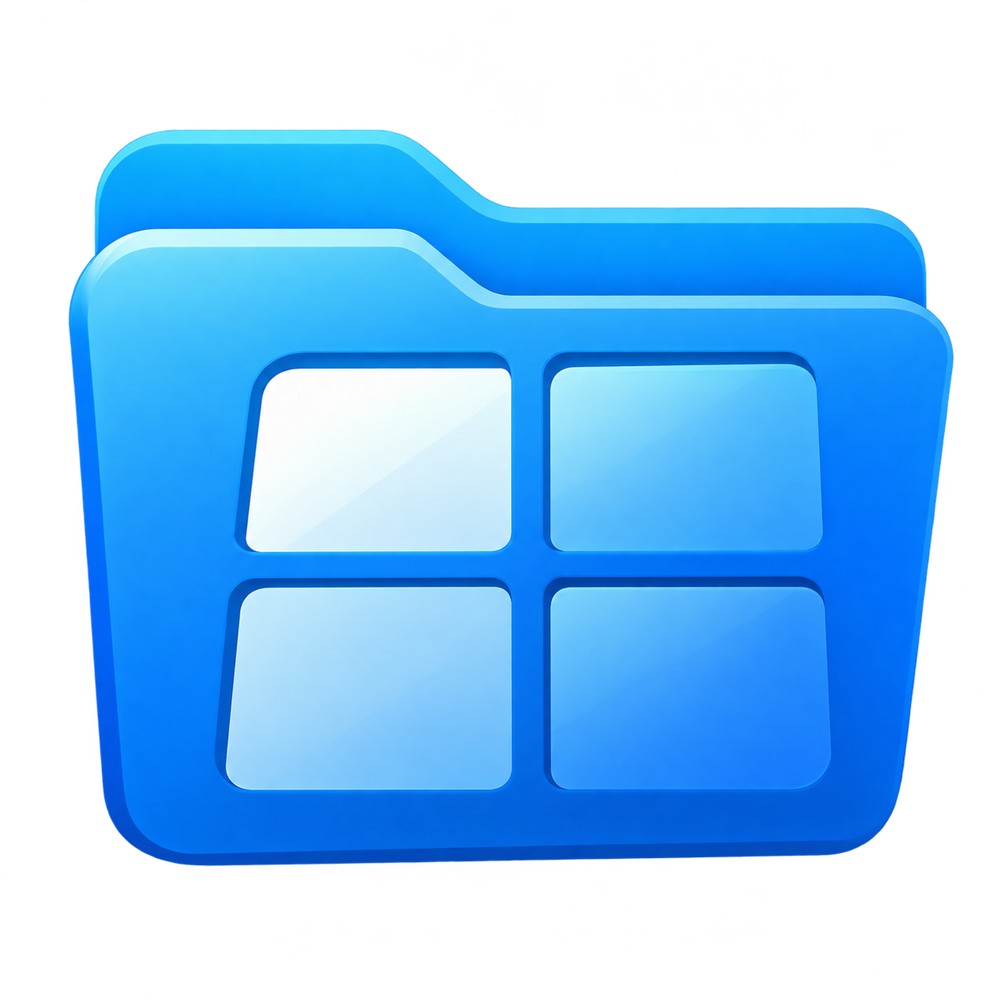
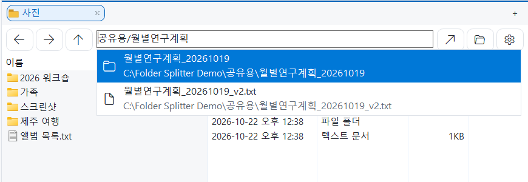
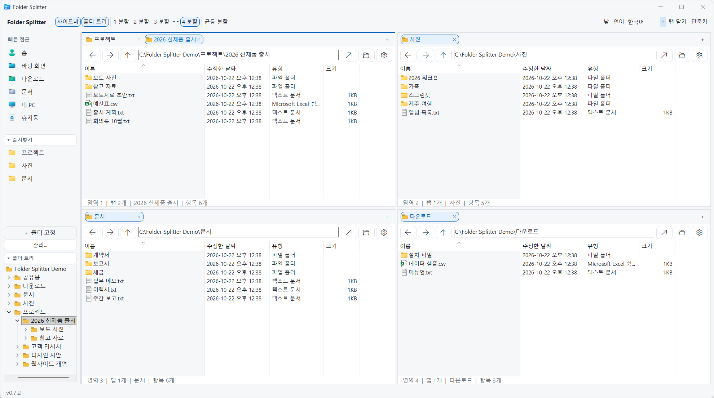

# Folder Splitter

**한국어** · [English](README.en.md) · [简体中文](README.zh-CN.md) · [日本語](README.ja.md)

한 창에서 최대 **4개 폴더를 동시에 보고, 각 영역에서 독립적인 탭을 사용하는 Windows 파일 관리자**입니다.

Windows 기본 파일 목록(Shell `IExplorerBrowser`)을 사용합니다. 기존 `explorer.exe`를 수정하거나 교체하지 않으며, 별도 앱으로 실행됩니다.

## 주소창이 곧 검색창

경로를 다 기억하지 못해도 됩니다. 주소창에 **기억나는 이름 조각**을 입력하면 입력하는 즉시 맞는 폴더와 파일이 아래에 펼쳐집니다. `공유용/월별연구계획`처럼 폴더와 파일 이름 조각을 `/`로 이어 쓰면 범위가 좁혀집니다.



- **폴더**를 고르면 그 폴더로 이동하고, **파일**을 고르면 파일이 있는 폴더를 열어 그 파일을 바로 선택해 줍니다.
- ↑/↓와 Enter, 또는 클릭으로 고릅니다. 현재 폴더, 열린 탭, 즐겨찾기, 최근 닫은 탭과 가까운 결과가 먼저 나옵니다.
- 로컬 드라이브를 자체 색인하므로 Everything 같은 별도 프로그램이 필요 없습니다. 파일 내용은 읽지 않습니다.

### 검색 속도

**약 372만 경로에서 p95 62ms.** 전체 중앙값과 p95 모두 Everything 연동보다 빠릅니다. 짧고 결과가 아주 많은 검색어에서는 Everything이 더 빠릅니다.

| 응답 시간 — 낮을수록 빠름 | 자체 엔진 | 비교용 Everything 연동 |
|---|---:|---:|
| 보통 응답 · 중앙값(p50) | **21.1ms** | 48.4ms |
| 요청 95%가 끝나는 경계(p95) | **62.1ms** | 164.6ms |
| 한글 부분 경로(p95) | **40.3ms** | 141.5ms |
| 짧고 매칭이 많은 검색어(p95) | 68.8ms | **7.1ms** |

2026-10-21, 약 372만 공통 후보에서 동일 순위·최대 100개 결과 조건으로 37개 질의, 엔진당 370회를 측정했습니다. 검색어에 따라 유불리는 다르며 Everything 자체의 내부 검색 시간만 비교한 표는 아닙니다. 최초 색인 약 **50초**는 위의 준비 후 검색 시간과 별개입니다. [측정 조건과 전체 결과](docs/search-evidence/benchmark.md)

## 예시 화면



실제 앱에서 샘플 폴더를 연 화면입니다. 각 영역의 탭과 주소창은 독립적으로 동작합니다.

## 실행

[최신 Windows 실행 파일 다운로드](https://github.com/HSoo-Kim/folder-splitter/releases/latest)

Windows 11 x64용입니다. 릴리스의 `folder-splitter-win-x64.zip`을 풀고 `FolderSplitter.exe`를 실행합니다. 배포 실행 파일에는 .NET 런타임이 포함되므로 별도 런타임 설치가 필요 없습니다.

초기 버전은 코드 서명되지 않았습니다. Windows가 다운로드한 앱의 게시자를 확인할 수 없다는 안내를 표시할 수 있습니다.

## 기능

### 화면 분할과 탭
- **1~4분할**: 상단 버튼이나 `Ctrl+1`~`Ctrl+4`로 바꿉니다. 3분할은 좌우·상하 2:1 배치도 고를 수 있습니다.
- **크기 조절**: 경계선을 끌어 조절하고, `균등 분할`로 되돌립니다.
- **영역별 탭**: 영역마다 탭을 따로 씁니다. 새 탭, 복제, 닫은 탭 복원을 지원합니다.
- **탭 끌어서 배치**: 파일 목록 가장자리에 놓으면 그 방향으로 나뉘고, 가운데에 놓으면 그 영역으로 옮겨집니다. 빈 칸에도 놓을 수 있습니다.
- **빈 칸**: 새로 나눈 영역은 비어 있습니다. 주소를 입력하거나 왼쪽 바로가기를 눌러 폴더를 엽니다.

### 탐색과 검색
- **주소창 검색**: 이름 일부만 입력해도 드라이브 전체에서 바로 찾습니다. [자세히](#주소창이-곧-검색창)
- **이동**: 경로 입력과 자동완성, 뒤로·앞으로·상위 폴더, 마우스 옆 버튼을 지원합니다.
- **폴더 찾아보기**: 주소창 옆 폴더 아이콘으로 폴더 선택 창을 엽니다.

### 사이드바
- **빠른 접근**: 사용자 폴더, 바탕화면, 다운로드, 문서, 최근 항목, 내 PC, 휴지통. 누르면 활성 영역(위쪽 파란 선)에 열립니다. `최근 항목`은 Windows 파일 탐색기처럼 최근에 연 파일과 폴더를 최신순으로 보여 줍니다.
- **즐겨찾기**: `Ctrl+D`로 추가하고 우클릭으로 뺍니다. 처음 실행할 때 탐색기의 고정 폴더를 가져오며, `관리...`에서 다시 가져오기·전체 제거·복원을 합니다. 탐색기 쪽에는 영향이 없습니다.
- **폴더 트리**: 활성 영역의 위치를 따라갑니다. 클릭은 현재 영역, 가운데 클릭·Ctrl+클릭은 새 탭, 우클릭은 새 영역이나 탐색기로 엽니다. `Ctrl+Shift+E`로 접습니다.
- **크기**: 사이드바 폭과 즐겨찾기·트리 높이를 경계선으로 조절하고, `사이드바` 버튼으로 숨깁니다.

### 파일 작업
- **Windows 기본 동작**: 우클릭 메뉴, 복사·잘라내기·붙여넣기, 이름 변경, 삭제, 영역 간 끌어 놓기를 Windows가 그대로 처리합니다.
- **보기**: 영역 옵션에서 자세히·목록·아이콘을 고르거나 같은 폴더를 Windows 파일 탐색기로 엽니다. 분류 방법(그룹화)·정렬·보기 방식은 탐색기처럼 폴더마다 기억합니다.
- **항목 수**: 영역 아래에 표시 중인 항목 수를 보여 주고 바로 갱신합니다.

### 화면과 설정
- **낮/밤 테마**: 상단 오른쪽 버튼으로 바꾸며, 파일 목록까지 함께 바뀝니다.
- **언어**: 한국어, English, 简体中文, 日本語.
- **작업 복원**: 탭, 즐겨찾기, 분할 비율, 창 크기, 테마, 사이드바 상태를 다음 실행에 그대로 이어 갑니다.
- **버전과 업데이트**: 왼쪽 아래에 현재 버전을 표시하고, 새 릴리스가 나오면 옆에 `업데이트`가 뜹니다. 누르면 새 버전을 받아 교체하고 다시 실행하며, 탭과 설정은 그대로입니다. 누르기 전에는 아무것도 설치하지 않습니다.

파일 목록은 Windows 기본 목록이라 열 정렬과 우클릭 메뉴를 Windows Shell이 처리합니다. Windows 11 탐색기의 상단 명령 모음과 탭 UI 자체를 넣은 것은 아닙니다.

## 빠르게 불러오기

| 상황 | 동작 |
|---|---|
| `Win+Alt+E` | 어디서든 창을 앞으로 가져옵니다. 다시 누르면 알림 영역으로 숨깁니다. |
| 창 닫기(X) | 종료하지 않고 알림 영역(숨겨진 아이콘)에 남습니다. 처음 한 번 안내가 뜹니다. |
| `Win+E` | `설정`에서 켠 경우에만 Folder Splitter가 열립니다. 기본은 파일 탐색기입니다. |
| 다시 실행 | 새 창 대신 기존 창을 불러옵니다. |

- **완전히 끄기**: 알림 영역 아이콘 우클릭 → `종료`.
- **`설정`에서 바꿀 수 있는 것**: Win+Alt+E 사용, 닫을 때 알림 영역에 남기기, Win+E 대체, 새 버전 확인, 업데이트 자동 설치.
- 알림 영역 옵션을 끄면 X는 종료, Win+Alt+E 재입력은 최소화로 바뀝니다.
- Win+E 설정은 현재 사용자 레지스트리(HKCU) 항목 하나만 만들고 지웁니다. 관리자 권한은 필요 없습니다.

## Q-Dir과 비교

두 프로그램은 파일을 찾는 방식이 다릅니다.

| | Q-Dir | Folder Splitter |
|---|---|---|
| 검색 위치 | 별도 검색창 (Windows 탐색기 검색, `F3`·`Ctrl+F`) | 주소창에 바로 입력 |
| 검색 범위 | 현재 폴더와 그 하위 | 모든 로컬 드라이브 |
| 속도 | Windows 검색 색인 여부에 따라 다르고, 색인되지 않은 위치는 느릴 수 있음 | 자체 파일 이름 색인으로 입력 즉시 결과 표시 (첫 색인 약 50초) |
| 외부 도구 | 기본 Everything 연동 없음 | 필요 없음 |

> **기준**: 2026-10-22에 Q-Dir 12.81(2026-10-18 공개)을 대상으로 정리했습니다. 공식 FAQ(검색 항목은 2024-04-29 갱신)와 공식 도움말을 참고했고, Q-Dir을 직접 설치해 확인하지는 않았습니다. 공식 문서에는 자체 검색 기능을 개발 중이라고 적혀 있어 이후 버전에서 달라질 수 있습니다. 틀린 내용은 이슈로 알려 주세요.
>
> 출처: [Q-Dir 공식 사이트](https://www.softwareok.com/?seite=Freeware/Q-Dir) · [검색 기능 FAQ](https://www.softwareok.com/?seite=faq-Q-DIR&faq=37) · [도움말](http://www.q-dir.com/?en-us-q-q-dir-file-explorer-help.-for-windows-10-11-12-7)

## 사용법

1. 상단에서 분할 수를 고릅니다.
2. 각 영역 주소창에 경로나 이름 일부를 입력하고 Enter를 누릅니다.
3. `+`로 탭을 추가하고, 탭을 끌어 원하는 칸에 배치합니다.
4. 파일 목록에서 Windows와 같은 단축키를 사용합니다.

### 단축키

| 키 | 동작 |
|---|---|
| `Ctrl+1`, `Ctrl+2`, `Ctrl+3`, `Ctrl+4` | 분할 방식 전환 |
| `F6` | 다음 영역으로 이동 |
| `Ctrl+T` | 현재 폴더를 새 탭으로 열기 |
| `Ctrl+W`, 탭의 ×, 탭 가운데 클릭 | 탭 닫기 |
| `Ctrl+Shift+T` | 닫은 탭 복원 |
| `Ctrl+Tab`, `Ctrl+Shift+Tab` | 다음/이전 탭 |
| `Ctrl+L`, `Alt+D` | 주소창 선택 |
| `Alt+Left`, `Alt+Right`, `Alt+Up` | 뒤로/앞으로/상위 폴더 |
| 마우스 뒤로/앞으로 버튼 | 포인터가 있는 영역에서 뒤로/앞으로 |
| `Ctrl+D` | 현재 폴더 즐겨찾기 |
| `Ctrl+Shift+E` | 폴더 트리 접기/펼치기 |
| `Win+Alt+E` | Folder Splitter 불러오기 / 다시 누르면 알림 영역으로 숨기기 |
| `F5` | 새로고침 |
| `Ctrl+C`, `Ctrl+X`, `Ctrl+V` | 선택 파일 복사/잘라내기/붙여넣기 |
| `F2` | 선택 파일 이름 변경 |
| `Delete` | 선택 항목 삭제: Windows Shell 정책 적용 |
| `Ctrl+Shift+N` | 새 폴더 |
| `F1` | 단축키 도움말 |

## 데이터와 호환성

- 새 버전 확인: 앱을 켤 때와 켜져 있는 동안 하루 한 번 GitHub(`api.github.com`)에서 최신 릴리스 정보만 읽습니다. 파일·사용자 정보는 보내지 않습니다. `설정` → `새 버전 확인`으로 끌 수 있습니다.
- 업데이트: `업데이트`를 누를 때만 GitHub 릴리스의 ZIP을 받습니다. GitHub가 알려 주는 SHA256과 맞는지 확인한 뒤 실행 파일을 바꾸고, 이전 파일은 다음 실행 때 지웁니다. 확인에 실패하면 아무것도 바꾸지 않습니다. 실행 파일이 쓰기 권한이 없는 위치에 있거나 `설정` → `업데이트를 누르면 자동으로 설치`를 끄면 릴리스 페이지를 엽니다. 이 두 가지 외의 인터넷 접속은 없습니다.
- 설정 위치: `%LOCALAPPDATA%\QuadExplorer\session.json`
- 이전 QuadExplorer 버전의 탭과 즐겨찾기를 유지하기 위해 설정 경로는 그대로 사용합니다.
- 같은 설정 파일을 사용하는 앱은 한 번에 하나만 실행합니다.
- 최대 영역당 32개 탭, 즐겨찾기 100개입니다.
- 연결이 끊긴 드라이브나 사라진 폴더는 오류를 표시하고 주소창으로 다른 폴더를 선택할 수 있습니다.
- 파일 삭제·덮어쓰기·충돌 처리는 Windows Shell에 위임합니다. 앱 자체가 사용자 파일을 재귀 삭제하지 않습니다.
- OneDrive/Dropbox 상태 표시, 제3자 Shell 확장, 네트워크 공유는 해당 공급자의 설치 상태와 권한에 영향을 받습니다.
- 준비된 로컬 고정 드라이브의 파일·폴더 이름과 경로를 백그라운드에서 색인합니다. 첫 실행은 색인 준비 표시가 나타나며, 다음 실행은 저장된 색인을 먼저 사용하고 변경 사항을 확인합니다. 파일 내용은 읽지 않습니다.
- 색인 캐시: `%LOCALAPPDATA%\FolderSplitter\Search\paths.v1.index`. 별도 `--session`은 설정 파일 옆의 `.search.index`를 사용합니다. 접근 권한이 없는 경로와 정션·심볼릭 링크의 내부는 검색하지 않습니다. 네트워크·이동식 드라이브는 기존 직접 경로 탐색을 사용합니다.
- 기본 탐색기 교체와 기존 탐색기 탭 가져오기는 포함하지 않습니다. 검색 비교와 한계는 [측정 기록](docs/search-evidence/benchmark.md)을 참고하세요.

별도 작업 세션이나 테스트용으로 설정 경로를 지정할 수 있습니다.

```powershell
.\FolderSplitter.exe --session C:\Work\folder-session.json C:\Projects D:\Research
```

추가 폴더 인수는 활성 영역의 새 탭으로 열립니다.

## 소스 빌드

필수: Windows 11 x64, .NET 10 SDK.

```powershell
.\build.ps1                 # Release 빌드 + 세션 회귀 테스트
.\build.ps1 -UiTests        # 실제 네이티브 창 통합 테스트 추가
.\build.ps1 -Publish        # 런타임 포함 실행 파일과 ZIP 생성
```

UI 통합 테스트는 `tools/PrivateDesktopQa`가 만든 별도의 비공개 Windows 데스크톱에서 실행하므로, 사용 중인 화면에 창을 띄우거나 마우스·키보드를 건드리지 않습니다. 로그인된 Windows 세션이 필요합니다. 테스트는 임시 폴더만 사용하며 탐색 완료 이벤트를 기다립니다. 고정 시간 지연에 의존하지 않습니다.

출력:

```text
artifacts/FolderSplitter/FolderSplitter.exe
artifacts/folder-splitter-win-x64.zip
```

## 구성

```text
src/FolderSplitter/
  MainForm.cs           창, 분할, 빠른 접근, 단축키
  ExplorerPane.cs       영역별 탭과 주소창
  ShellViewHost.cs      네이티브 Shell 보기 수명 관리
  ShellInterop.cs       Windows SDK COM/PInvoke 선언
  SessionState.cs       설정 검증과 원자적 저장
  Theme.cs              낮/밤 테마와 둥근 공통 컨트롤
  FolderTree.cs         왼쪽 폴더 트리
  ShellIconCache.cs     빠른 접근 Windows 아이콘
  Assets/               앱 아이콘 원본 PNG와 다중 해상도 ICO
tests/
  QuadExplorer.Tests/   설정 모델 회귀 테스트
  QuadExplorer.UiTests/ 실제 Shell 보기 통합 테스트
tools/
  PrivateDesktopQa/     비공개 데스크톱 UI 테스트 실행기
```

앱 코드에는 외부 NuGet 패키지 의존성이 없습니다(UI 테스트만 Lib.Harmony 사용). Windows Shell과 .NET Windows Forms를 사용합니다.

아이콘 원본을 교체할 때는 아래 명령으로 Windows용 ICO를 다시 생성합니다.

```powershell
.\tools\Build-Icon.ps1 -SourcePng .\src\FolderSplitter\Assets\app.png
```

## 라이선스

[MIT 라이선스](LICENSE)입니다. 개인과 회사 모두 무료로 사용·수정·배포할 수 있으며, 배포할 때는 저작권 및 라이선스 고지를 함께 포함하면 됩니다.
