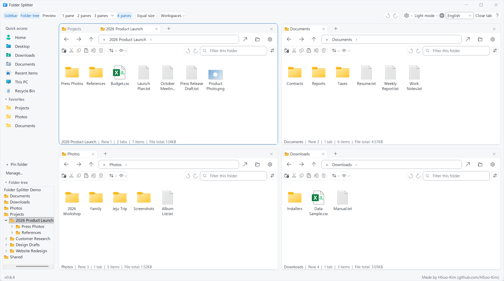
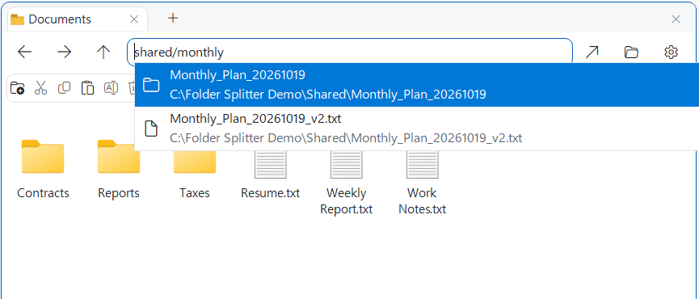
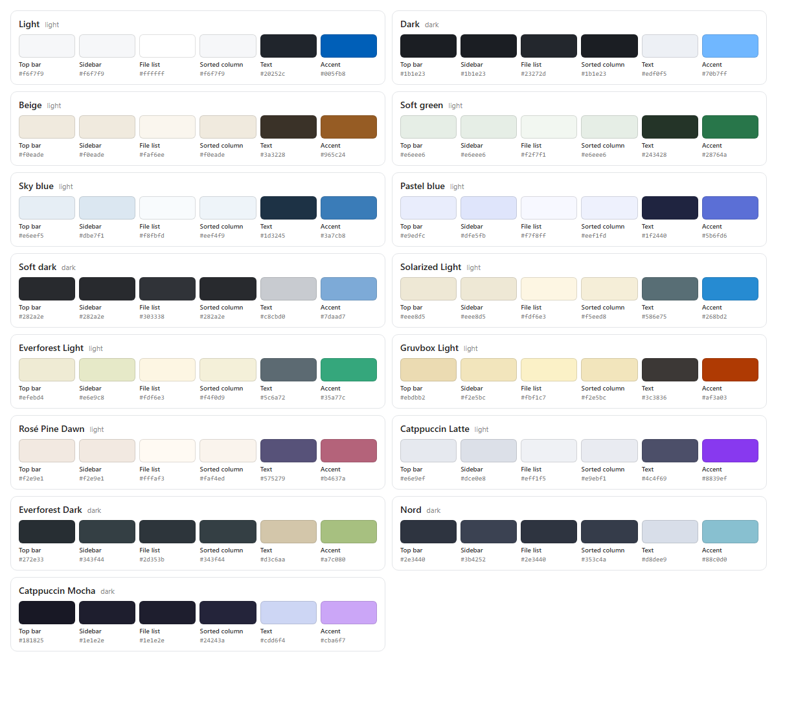

<div align="center">


# Folder Splitter

**Up to four folders in one window, each pane with its own tabs. Find anything by typing a fragment.**

<p>
  <a href="https://github.com/HSoo-Kim/folder-splitter/releases/latest/download/folder-splitter-win-x64.zip"></a>
  <a href="https://github.com/HSoo-Kim/folder-splitter/releases/latest"></a>
  <a href="https://github.com/HSoo-Kim/folder-splitter/releases"></a>
  <a href="https://github.com/HSoo-Kim/folder-splitter/stargazers"></a>
  <a href="LICENSE"></a>
</p>

<p>
  <b>English</b> ·
  <a href="README.ko.md">한국어</a> ·
  <a href="README.zh-CN.md">简体中文</a> ·
  <a href="README.ja.md">日本語</a>
</p>



</div>

A Windows file manager built on the native Shell file list (`IExplorerBrowser`). It doesn't modify or replace `explorer.exe` and runs as a separate app.

## Key Capabilities

| Feature | What it does |
|---|---|
| **Fast search** | Type name or path fragments into the address bar. An index the app keeps itself typically answers in about 10 ms across 2.3 million paths, with no Everything install and no file contents read. [Details](#the-address-bar-is-a-search-box) |
| **Four panes, independent tabs** | Keep source, destination and reference folders side by side. Drag tabs between panes, or to an edge to split. |
| **Undo closed tabs and panes** | `Ctrl+Shift+T` restores the last closed tab or split with its position and proportions. Each pane also has its own undo. |
| **Preview in place** | View images and multi-page PDFs beside the list. Pin a file, or open previews in separate windows to compare. |
| **Compare and organize** | Find files that exist on one side only, are newer or differ in size, then copy or move them to the other pane. Batch renames show every new name first. |
| **Pick up where you left off** | Tabs and layout restore on launch. Save named workspaces, and bring the app back from anywhere with `Win+Alt+E`. |
| **Native, and yours to adjust** | Windows context menus, drag and drop and copy dialogs stay native. Choose from 15 themes, fonts, row spacing and an optional command bar. |

[Full feature list](#features)

## Quick Start

1. Download [folder-splitter-win-x64.zip](https://github.com/HSoo-Kim/folder-splitter/releases/latest/download/folder-splitter-win-x64.zip) (Windows 11, or Windows 10 version 2004 or later, x64).
2. Extract it and run `FolderSplitter.exe`. There is nothing to install; the .NET runtime is bundled.
3. Type a name fragment into a pane's address bar, or pick a folder from the sidebar.

Early versions aren't code-signed, so Windows may warn that it can't verify the publisher. Development and testing happen on Windows 11.

## The address bar is a search box

You don't need the full path. Type **any fragment you remember** into the address bar and matching folders and files appear as you type. Join folder and file name fragments with `/`, such as `shared/monthly`, to narrow the results.



- Choose a **folder** to go there; choose a **file** to open its folder with that file selected.
- Use Up/Down and Enter, or click. Results near the current folder, open tabs, favorites and recently closed tabs come first.
- Local drives are indexed by the app itself, so no separate tool such as Everything is needed. File contents are never read.

### How to search

Say you are looking for `D:\Research\KMA500m_15min_shared_20261020\Raw_data_15min_rain\rn_15m_2022_08.nc`:

| Type | Rule | Finds |
|---|---|---|
| `rn 2022_08` | Space-separated fragments must **all appear in the name**. | `rn_15m_2022_08.nc` |
| `nc 15m 2022` | **Order doesn't matter**, and fragments can come from the middle of the name. | `rn_15m_2022_08.nc` |
| `.NC 2022_08` | Case doesn't matter. | `rn_15m_2022_08.nc` |
| `shared_2026` | Folders are found by name fragments too. | the `KMA500m_15min_shared_20261020` folder |
| `15min_rain/rn_15m` | Join with `/` to follow the path: the first fragment is the end of a folder name, the next is the start of an item inside it. | the `rn_15m_…` files |
| `"meeting notes"` | Wrap names that contain spaces in quotes. | `meeting notes.docx` and so on |

Space-separated fragments are matched against each file's or folder's **own name**. Mixing a parent folder's name with a file-name fragment, as in `shared nc`, therefore finds nothing; use only file-name fragments (`rn nc`) or join the path with `/`.

### Search speed

**Across about 2.3 million paths a search typically takes 10 ms, and 95% finish within 31 ms.** (0.7.17, measured 2026-10-23)

| Query type | Typical (p50) | 95th percentile (p95) |
|---|---:|---:|
| Name fragments | 9.4 ms | 22.2 ms |
| Name fragments, different case | 9.4 ms | 22.0 ms |
| Partial paths (`folder/name`) | 11.5 ms | 12.7 ms |
| Korean partial path | 16.1 ms | 16.5 ms |
| Short terms with very many matches | 32.8 ms | 95.3 ms |
| Terms with no match | 8.0 ms | 8.1 ms |
| **Overall** | **9.6 ms** | **31.0 ms** |

Measured over the whole C drive (index exclusions applied, 2,298,670 paths) with 37 queries, top 100 results and 6 priority folders: 3 warm-up passes, then 5 measured passes (185 calls). Ryzen 9 9950X, Windows 11. Building the index took about 26 s and loading the saved index 0.25 s.

**Compared with Everything** (2026-10-21, earlier engine, about 3.72 million paths without exclusions): overall p95 was 62.1 ms for Folder Splitter and 164.6 ms through Everything, while Everything was faster for short terms with very many matches (68.8 ms vs 7.1 ms). The engine and index scope have changed since, and the Everything comparison has not been repeated. [Method and full results](docs/search-evidence/benchmark.md)

### Lightweight

| Item | Value |
|---|---|
| App memory (just after launch, 4 panes) | about 280 MB |
| CPU while idle | under 1% |
| Search index memory | about 150 MB (about 2.3 million paths) |
| New files reach search | in 2–3 seconds |

Constantly changing system folders (Windows, `ProgramData`, `AppData` and so on) are not indexed, and changes are applied in batches, so the app uses almost no CPU while idle. Figures are from the developer's PC and depend on the number of files; memory can grow somewhat over a long session (about 460 MB after several hours here). 0.7.14 used about 1.2 GB on the same PC just after launch.

## Features

### Panes and tabs
- **1 to 4 panes**: Switch from the top bar or with `Ctrl+1`–`Ctrl+4`. Three panes can also be arranged 2:1 side by side or top and bottom.
- **Resizing**: Drag the dividers; `Equal size` evens them out again.
- **Tabs per pane**: Each pane has its own tabs. `+` or `Ctrl+T` opens a blank tab ready for typing; to open the same folder again, right-click the tab → `Duplicate tab`. Closed tabs can be reopened.
- **Tab width and tab list**: Tabs grow and shrink with the folder name, and a lone tab shows more of a long name. With many tabs they shrink evenly; when they still do not fit, the `▾` button next to `+` lists every tab.
- **Drag tabs into place**: Drop a tab near a file-list edge to split in that direction, or in the center to move it into that pane. Empty panes accept tabs too.
- **Empty panes**: New split panes start empty. Type an address or click a sidebar shortcut to open a folder.
- **Keep the pane you are using**: Switching to one pane keeps the active pane; if it has no tabs, a visible pane with tabs is kept instead. Hidden panes retain their tabs.
- **Close and restore splits**: `Ctrl+W` closes a tab. Press it again when the pane has no tabs to collapse that split; the final pane stays open. `Ctrl+Shift+T` reverses the close order: restore the empty split at its original position and proportions, then press again to restore its tab. Choosing a new layout clears earlier split-restore records.
- **Readable shortcut help**: `?` or `F1` opens a themed guide with category navigation and separate shortcut/description columns. It follows your font settings and wraps on narrow windows.
- **Two kinds of close history**: The circular undo/redo buttons beside each pane's filter box reopen only that pane's closed tabs. The pair at the top right, left of `Settings`, covers every tab and split closed in any pane and matches `Ctrl+Shift+T`. Restoring from either never brings the same item back twice. Hover any of them for its scope and shortcut.

### Navigation and search
- **Address-bar search**: Type part of a name to find it across all local drives instantly. [Details](#the-address-bar-is-a-search-box)
- **Moving around**: Path input with autocomplete, back/forward/up, and the mouse side buttons.
- **Path buttons**: The address bar shows each folder as a button (`C: › Users › …`). Click one to go there, or click `›` for its subfolders. Click an empty spot or press `Ctrl+L` to type a path or search as before.
- **Recent locations**: Right-click the back or forward button for the folders this tab has visited.
- **Browse for a folder**: The folder icon beside the address bar opens a folder picker.

### Sidebar
- **Quick access**: User folder, Desktop, Downloads, Documents, Recent items, This PC and Recycle Bin. Clicking opens in the active pane (blue line at the top). `Recent items` lists recently opened files and folders, newest first, as in File Explorer.
- **Favorites**: Add with `Ctrl+D`, remove by right-click. File Explorer's pinned folders are imported on first launch; `Manage...` re-imports, removes all or restores. Explorer itself is not changed.
- **Folder tree**: Follows the active pane. Click opens in the current pane, middle-click or Ctrl+click in a new tab, right-click in a new pane or File Explorer. `Ctrl+Shift+E` collapses it.
- **Size**: Drag to set the sidebar width and the favorites/tree height; `Sidebar` hides it.

### Files
- **Native Windows actions**: Right-click menu, copy/cut/paste, rename, delete and drag and drop between panes are handled by Windows as usual.
- **Command bar**: Above each file list, like File Explorer: New folder, Cut, Copy, Paste, Rename and Delete (to the Recycle Bin, undoable with `Ctrl+Z`). Hover a button for its name and shortcut.
- **Sort and View menus**: Sort by name, date modified, type or size, ascending or descending, and group by type or date. View switches between extra large to small icons, List, Details, Tiles and Content, and has File Explorer's `Show hidden items` and `Show file name extensions` (Windows-wide settings, so File Explorer follows too) and the details pane.
- **Quick filter**: Type in the box at the right of the command bar to list only the names in this folder that contain it (several words must all match). `Esc` clears it, and it clears by itself when the tab opens another folder.
- **Rename several items at once**: Select two or more items and press `Rename` on the command bar. Find and replace text (or a regular expression), add a running number with `{n}` and check every new name before applying; the extension is kept, clashes are refused, and one `Ctrl+Z` in File Explorer undoes it.
- **Details pane**: `View` → `Details pane` lists the selected item's properties under the preview, as File Explorer does: type, location, size and dates, plus dimensions for images, length for media and authors for documents.
- **Compare two panes**: `⇄` on the command bar compares this folder with the other pane's: items on one side only, newer files and files of a different size. A button selects those items in either pane, ready to copy.
- **Views**: Pick Details, List or Icons from the pane options, or open the same folder in File Explorer. Grouping, sort order and view mode are remembered per folder, as in File Explorer.
- **Item count and selection**: Each pane shows how many items it displays and, with a selection, the count and total file size (for example `3 selected · 1.2 GB`).
- **Preview**: Enable it with `Preview` or `Alt+P`, then click a file. Its visibility and width are remembered.
- **Pin and new window**: `Pin` at the top of the preview keeps the current file while you select others. `New window` opens that file in its own preview window, so several can sit side by side for comparison (up to 8; PDF wheel paging works there too).
- **Copy or move to the other pane**: `Ctrl+Alt+C` (copy), `Ctrl+Alt+X` (move) or the pane options (⚙) send the selection to the other pane's folder, meaning the pane you used just before. The same Windows copy dialog as File Explorer handles progress, name conflicts and undo (`Ctrl+Z`).
- **Copy path, terminal**: `Ctrl+Shift+C` copies the selected items' paths in quotes, like File Explorer (the current folder when nothing is selected). `Open terminal here` in the pane options opens Windows Terminal (or PowerShell) in that folder.
  - **Multi-page PDFs**: No separate PDF app is needed. Wheel down over the preview for the next page, or up for the previous page. The page number and previous/next buttons appear below.
  - **Separate window**: Drag the file-name header or click `Detach preview`. Drag it back over the main window's right side or click `Dock preview` to put it back; the current PDF page is preserved.
  - **Other formats**: Photos use Windows thumbnails; Office, text and other documents use installed Explorer preview handlers. Wheel input over a document goes to its handler rather than the file list; scrolling and paging support depend on the handler.

### Appearance and settings
- **Color themes**: Choose from 15 in the menu at the top right: the standard `Light` and `Dark`, the easier-on-the-eyes `Beige`, `Soft green`, `Sky blue`, `Pastel blue` and `Soft dark`, and eight mixed palettes based on well-known design palettes (Solarized, Everforest, Gruvbox, Rosé Pine, Catppuccin, Nord) that give the top bar, sidebar, file list and sorted column their own colors.
  
- **Font and text size**: In `Settings` → `Font and text size`, pick an installed font (Malgun Gothic, Pretendard, NanumGothic and others) and small, normal or large text; the file lists change too.
- **List appearance**: Each pane's `View` menu groups its options by scope: this pane only, all panes, and Windows-wide settings. For all panes you can hide the command bar (the filter is still on `Ctrl+F` and the other commands are in the pane options), toggle vertical separators and sorted-column highlighting (both off by default), and choose `Compact` or `Comfortable` row spacing (default). Comfortable spacing only adds room between rows; icons and text keep their size.
- **Folder file total**: The status line shows the total size of the files directly in the current folder, such as `Files here: 18.4 MB`. Subfolders are not scanned, so it is a single folder read with no load on the PC; network folders are skipped.
- **Languages**: 한국어, English, 简体中文, 日本語.
- **Session restore**: Tabs, favorites, split ratios, window size, theme and sidebar state carry over to the next launch.
- **Workspaces**: `Workspaces` at the top saves the current panes and tabs under a name and opens them again later (up to 20). Handy when switching between projects.
- **Version and updates**: The lower left shows the current version and, when a new release is out, `Update` beside it. Clicking it downloads the new version, swaps it in and restarts, keeping your tabs and settings. Nothing is installed until you click. It checks when the app starts, every hour while it runs, and again when you bring the window back after 15 minutes or more.
- **Memory cleanup**: The Windows File Explorer component used for the file lists keeps a little memory for every folder visited and only returns it when the app exits. Once memory grew past a threshold (100 MB by default), the app saves its tabs, layout and settings and restarts quietly while the window is hidden or minimized. In `Settings` → `Memory cleanup` choose 100, 200, 300 or 500 MB or Off, or restart right away with `Clean up memory now`.

File lists are native Windows lists, so column sorting and right-click menus are handled by the Windows Shell. The Windows 11 Explorer command bar and tab UI are not embedded.

## Summoning the app

| Situation | What happens |
|---|---|
| `Win+Alt+E` | Brings the window to the front from any app; press again to hide it to the notification area. |
| Closing the window (X) | The app keeps running among the hidden icons in the notification area. A one-time notice explains this. |
| `Win+E` | Opens Folder Splitter only if turned on in `Settings`; otherwise File Explorer opens. Pressing it again while the app is in front hides it, like Win+Alt+E. |
| Launching it again | Brings the existing window back instead of opening another. |

- **Quit completely**: Right-click the notification-area icon → `Exit`.
- **In `Settings`**: Win+Alt+E, keeping running in the notification area, Win+E replacement, update checks and automatic update install.
- With the notification-area option off, X quits and a second Win+Alt+E minimizes.
- The Win+E setting only creates and removes one entry in your user registry (HKCU) and needs no administrator rights.

## Compared with Q-Dir

The two apps find files in different ways.

| | Q-Dir | Folder Splitter |
|---|---|---|
| Where you search | A separate search box (Windows Explorer search, `F3`/`Ctrl+F`) | Directly in the address bar |
| Scope | The current folder and its subfolders | All local drives |
| Speed | Depends on Windows Search indexing; unindexed locations can be slow | Results as you type from its own file-name index (first indexing about 50 s) |
| External tools | No built-in Everything integration | None needed |

> **Basis**: Compiled on 2026-10-22 for Q-Dir 12.81 (released 2026-10-18) from the official FAQ (search entry updated 2024-04-29) and the official help, without installing Q-Dir. The official documents say a search function of its own is in development, so later versions may differ. Please open an issue if something is wrong.
>
> Sources: [Q-Dir official site](https://www.softwareok.com/?seite=Freeware/Q-Dir) · [search FAQ](https://www.softwareok.com/?seite=faq-Q-DIR&faq=37) · [help](http://www.q-dir.com/?en-us-q-q-dir-file-explorer-help.-for-windows-10-11-12-7)

## Usage

1. Choose the number of panes at the top.
2. Type a path or part of a name into a pane's address bar and press Enter.
3. Add tabs with `+` and drag them into the panes you want.
4. Use the usual Windows shortcuts in the file list.

### Keyboard shortcuts

| Key | Action |
|---|---|
| `Ctrl+1`, `Ctrl+2`, `Ctrl+3`, `Ctrl+4` | Switch layout |
| `F6` | Move to the next pane |
| `Ctrl+T`, `+` | New blank tab |
| `Ctrl+W`, tab ×, middle-click a tab | Close tab |
| `Ctrl+W` in a pane with no tabs | Close that split (keep at least one pane) |
| `Ctrl+Shift+T` | Restore the last closed tab or empty split |
| `Ctrl+Tab`, `Ctrl+Shift+Tab` | Next/previous tab |
| Mouse wheel or wheel tilt over the tab row | Previous/next tab |
| `Ctrl+L`, `Alt+D` | Select the address bar |
| `Ctrl+F` | Filter in this folder (opens a filter box when the command bar is hidden) |
| `Alt+Left`, `Alt+Right`, `Alt+Up` | Back/forward/parent folder |
| Mouse back/forward buttons | Back/forward in the pane under the pointer |
| `Ctrl+D` | Add the current folder to favorites |
| `Ctrl+Shift+C` | Copy the selected items' paths (current folder if nothing is selected) |
| `Ctrl+Alt+C`, `Ctrl+Alt+X` | Copy / move the selection to the other pane |
| Right-click back or forward | Recent locations |
| `Ctrl+Shift+E` | Collapse or expand the folder tree |
| `Alt+P` | Show / hide the preview pane |
| `Win+Alt+E` | Bring Folder Splitter to the front / again to hide it |
| `F5` | Refresh |
| `Ctrl+C`, `Ctrl+X`, `Ctrl+V` | Copy/cut/paste selected files |
| `F2` | Rename selected file |
| `Delete` | Delete selected items: Windows Shell policy applies |
| `Ctrl+Shift+N` | New folder |
| `F1` | Shortcut help |

## Data and compatibility

- Update check: On launch and once a day while running, the app reads only the latest release information from GitHub (`api.github.com`). No file or user information is sent. Turn it off under `Settings` → `Check for new versions`.
- Updating: Only when you click `Update`, the app downloads the ZIP from the GitHub release, checks it against the SHA-256 GitHub reports, then replaces the executable; the previous file is deleted on the next start. If the check fails, nothing changes. If the executable sits where you can't write, or `Settings` → `Install automatically when Update is clicked` is off, the release page opens instead. The app makes no other network connections.
- Settings location: `%LOCALAPPDATA%\QuadExplorer\session.json`
- The settings path is unchanged so tabs and favorites from earlier QuadExplorer versions carry over.
- Run only one app instance at a time against the same settings file.
- Limits: up to 32 tabs per pane and 100 favorites.
- For a disconnected drive or a folder that no longer exists, the app shows an error and you can pick another folder from the address bar.
- Deleting, overwriting, and conflict handling are delegated to the Windows Shell. The app itself never recursively deletes user files.
- OneDrive/Dropbox status indicators, third-party Shell extensions, and network shares depend on the provider's installation state and permissions.
- Ready local fixed drives are indexed in the background by file/folder name and path, not file contents. The first run shows index preparation; later runs use the saved snapshot while reconciling changes.
- Not indexed: the contents of the Windows folder, `ProgramData`, every profile's `AppData`, the recycle bin and `System Volume Information`. These hold mostly program internals that change constantly, so leaving them out greatly reduces memory and CPU use. The folders themselves are still found by name, and typing their path opens them as usual.
- New or changed files reach search about 2–3 seconds after changes settle (at least every 10 seconds while they keep changing).
- Cache: `%LOCALAPPDATA%\FolderSplitter\Search\paths.v1.index`. An explicit `--session` uses an adjacent `.search.index` file. Inaccessible paths and junction/symlink contents are excluded. Network and removable drives retain direct-path navigation.
- Replacing File Explorer and importing its existing tabs aren't included. See the [benchmark and limitations](docs/search-evidence/benchmark.md).

You can point to a different settings path for a separate work session or for testing.

```powershell
.\FolderSplitter.exe --session C:\Work\folder-session.json C:\Projects D:\Research
```

Extra folder arguments open as new tabs in the active pane.

## Building from source

Requirements: Windows 10 (2004 or later) or 11 x64, .NET 10 SDK.

```powershell
.\build.ps1                 # Release build + session regression tests
.\build.ps1 -UiTests        # Add integration tests against real native windows
.\build.ps1 -Publish        # Produce runtime-bundled executable and ZIP
```

The UI integration tests run on a separate private Windows desktop created by `tools/PrivateDesktopQa`, so they never open windows on the screen you're using or touch your mouse and keyboard. A signed-in Windows session is required. The tests only use temporary folders and wait for navigation-complete events. They don't rely on fixed time delays.

Output:

```text
artifacts/FolderSplitter/FolderSplitter.exe
artifacts/folder-splitter-win-x64.zip
```

## Project layout

```text
src/FolderSplitter/
  MainForm.cs           Window, splits, quick access, shortcuts
  ExplorerPane.cs       Per-pane tabs and address bar
  ShellViewHost.cs      Native Shell view lifetime management
  ShellInterop.cs       Windows SDK COM/PInvoke declarations
  SessionState.cs       Settings validation and atomic saving
  Theme.cs              Color themes and rounded shared controls
  FolderTree.cs         Left folder tree
  ShellIconCache.cs     Windows icons for quick access
  Assets/               Source PNG for the app icon and multi-resolution ICO
tests/
  QuadExplorer.Tests/   Settings model regression tests
  QuadExplorer.UiTests/ Integration tests with real Shell views
tools/
  PrivateDesktopQa/     Private-desktop UI test launcher
```

The app code has no external NuGet package dependencies (only the UI tests use Lib.Harmony). It uses the Windows Shell and .NET Windows Forms.

When you replace the source icon, regenerate the Windows ICO with the command below.

```powershell
.\tools\Build-Icon.ps1 -SourcePng .\src\FolderSplitter\Assets\app.png
```

## License

[MIT License](LICENSE). Free for personal and commercial use, modification and distribution; keep the copyright and license notice in copies you distribute.
