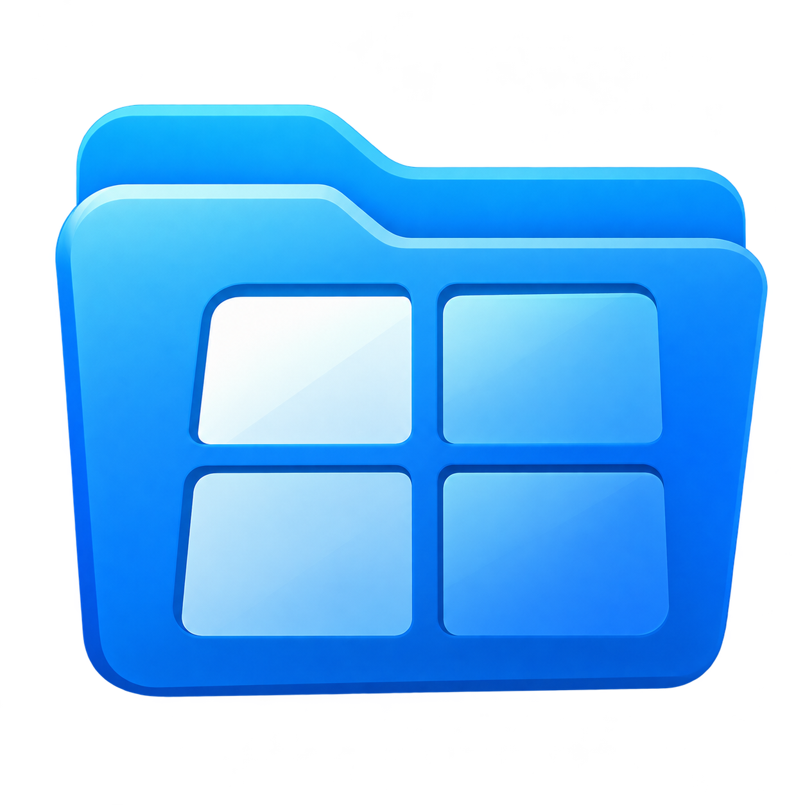
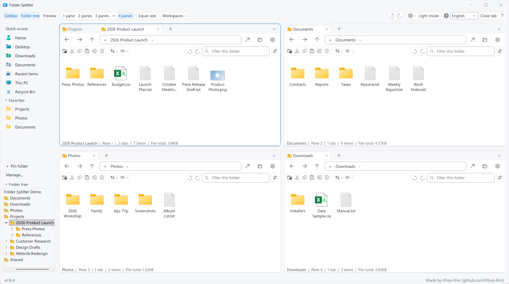
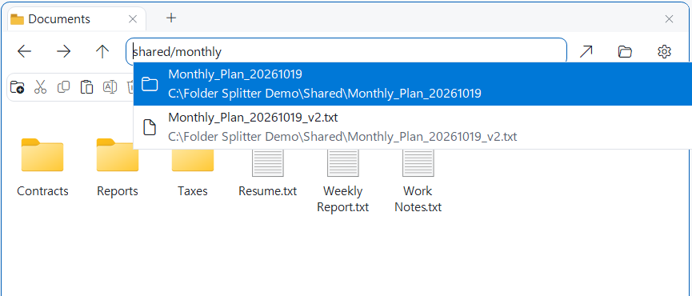
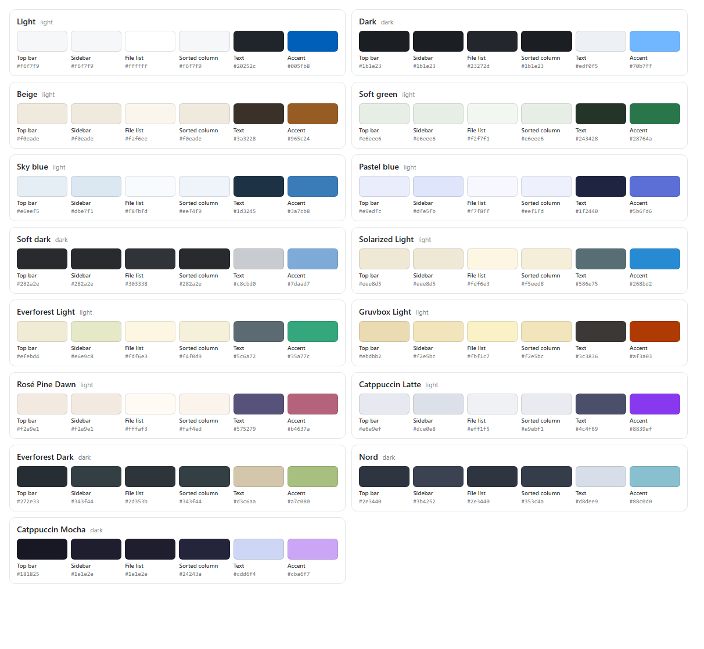

<div align="center">



# Folder Splitter

**一个窗口最多 4 个文件夹，每个区域独立标签页。输入名称片段即可立即查找。**

<p>
  <a href="https://github.com/HSoo-Kim/folder-splitter/releases/latest/download/folder-splitter-win-x64.zip"></a>
  <a href="https://github.com/HSoo-Kim/folder-splitter/releases/download/mac-v0.1.4/folder-splitter-mac.zip"></a>
  <a href="https://github.com/HSoo-Kim/folder-splitter/releases/latest"></a>
  <a href="https://github.com/HSoo-Kim/folder-splitter/releases"></a>
  <a href="https://github.com/HSoo-Kim/folder-splitter/stargazers"></a>
  <a href="LICENSE"></a>
</p>

<p>
  <a href="README.md">English</a> ·
  <a href="README.ko.md">한국어</a> ·
  <b>简体中文</b> ·
  <a href="README.ja.md">日本語</a>
</p>



</div>

基于 Windows 原生文件列表（Shell `IExplorerBrowser`）的文件管理器。它不会修改或替换 `explorer.exe`，而是作为独立应用运行。

## 核心功能

| 功能 | 说明 |
|---|---|
| **快速搜索** | 在地址栏输入名称或路径片段。应用自行维护的索引在约 230 万条路径中通常 10 ms 内返回结果，无需安装 Everything，也不读取文件内容。[详情](#地址栏就是搜索框) |
| **四分区与各自独立的标签页** | 将源、目标和参考文件夹并排放在一个窗口中。可用中键或 `Ctrl+Enter` 在新标签页中打开文件夹，跨区域拖动标签页，或拖到边缘进行分屏。 |
| **Chrome 式标签页组** | 将最多 12 个标签页编成有名称和颜色的组，可折叠或保存到侧边栏。拖动时在组末尾停留 0.3 秒即可加入该组。常用标签页可固定在最前面。 |
| **多窗口** | `Ctrl+N` 打开新窗口。可在窗口之间拖动标签页和组，或拖到窗口外分离为新窗口；下次启动时所有窗口都会恢复。 |
| **跨窗口文件拖放** | 在多个可见区域或窗口中按住 Ctrl 单击选择文件和文件夹，然后一起拖动。 |
| **已关闭标签页与区域的恢复** | `Ctrl+Shift+T` 恢复最近关闭的标签页或分屏，包括位置和比例。每个区域也有自己的撤销按钮。 |
| **就地预览** | 在列表旁查看图片和多页 PDF。可固定文件，或在独立窗口中并排对照。 |
| **文件夹比较与整理** | 找出仅一侧存在、较新或大小不同的文件，并复制或移动到另一区域。批量重命名会先显示所有新名称。 |
| **会话与工作区恢复** | 启动时恢复标签页、组和布局。可按名称保存工作区，用 `Win+Alt+E` 随时调出。 |
| **更新通知** | 新版本提供摘要时，在右下角显示主要变化及更新或下载按钮。 |
| **原生操作与自定义外观** | Windows 右键菜单、拖放和复制对话框保持原生。提供 15 种主题或自选颜色、字体、行间距和命令栏开关。 |

[完整功能介绍](#功能)

## 快速开始

1. 下载 [folder-splitter-win-x64.zip](https://github.com/HSoo-Kim/folder-splitter/releases/latest/download/folder-splitter-win-x64.zip)（Windows 11，或 Windows 10 2004 及更高版本，x64）。
2. 解压后运行 `FolderSplitter.exe`。无需安装，已内置 .NET 运行时。
3. 在区域的地址栏输入名称片段，或从侧边栏选择文件夹。

**Mac：** 下载 [folder-splitter-mac.zip](https://github.com/HSoo-Kim/folder-splitter/releases/download/mac-v0.1.4/folder-splitter-mac.zip)（macOS 15 及更高版本，Apple 芯片或 Intel），解压后将 **Folder Splitter** 移到“应用程序”文件夹。首次打开时会提示“未打开”：点按 **完成**（不是“移到废纸篓”），然后在“系统设置 ▸ 隐私与安全性”底部点按 **仍要打开** ▸ 输入密码 ▸ 再次点按 **仍要打开**。详情：[发布说明](https://github.com/HSoo-Kim/folder-splitter/releases/tag/mac-v0.1.4) · [mac/README.md](mac/README.md)

早期版本没有代码签名，Windows 可能会提示无法验证发布者。开发与测试在 Windows 11 上进行。

## 地址栏就是搜索框

无需记住完整路径。在地址栏输入**记得的任意名称片段**，匹配的文件夹和文件会随输入立即显示。用 `/` 连接文件夹名和文件名片段，例如 `shared/monthly`，即可缩小范围。



- 选择**文件夹**会进入该文件夹；选择**文件**会打开其所在文件夹并选中该文件。
- 搜索结果显示与文件列表相同的图标，包括其他程序附加在图标上的标记，例如同步状态或文档安全锁。
- 使用上下键和 Enter，或直接点击选择。靠近当前文件夹、已打开标签页、收藏夹和最近关闭标签页的结果优先显示，其后是常打开的文件夹（打开 3 次以上）中的结果。
- 列表从最匹配的 50 个结果开始。若还有更多，选择 **显示更多结果**（按 ↓ 到最后一行再按 Enter，或直接点击）可显示至 200 个，再选一次可显示至 500 个。之后请输入更多名称来缩小范围。
- 应用自行为本地驱动器建立索引，无需安装 Everything 等工具，也不会读取文件内容。

### 搜索方法

例如要找 `D:\研究\KMA500m_15分_资料共享_20261020\Raw_data_15min_rain\rn_15m_2022_08.nc`：

| 输入 | 规则 | 结果 |
|---|---|---|
| `rn 2022_08` | 用空格分开的片段**全部出现在名称中**即可找到。 | `rn_15m_2022_08.nc` |
| `nc 15m 2022` | **顺序无关**，也可以是名称中间的片段。 | `rn_15m_2022_08.nc` |
| `.NC 2022_08` | 不区分大小写。 | `rn_15m_2022_08.nc` |
| `资料共享` | 文件夹同样可以用名称片段查找。 | `KMA500m_15分_资料共享_20261020` 文件夹 |
| `15min_rain/rn_15m` | 用 `/` 连接即可沿路径缩小范围：前一个片段是文件夹名的结尾，后一个是其中项目名的开头。 | `rn_15m_…` 文件 |
| `"会议 资料"` | 名称中含空格时用引号括起来。 | `会议 资料.pptx` 等 |

用空格分开的片段只在每个文件或文件夹**自己的名称**中查找。因此像 `资料共享 nc` 这样混用上级文件夹名和文件名片段时不会有结果；请只用文件名片段（`rn nc`），或用 `/` 连接路径。

### 搜索速度

**在约 230 万条路径中，搜索通常只需 10ms，95% 的请求在 31ms 内完成。**（0.7.17，2026-10-23 测量）

| 搜索词类型 | 通常(p50) | 95% 分位(p95) |
|---|---:|---:|
| 名称片段 | 9.4ms | 22.2ms |
| 大小写不同的名称片段 | 9.4ms | 22.0ms |
| 部分路径（`文件夹/名称`） | 11.5ms | 12.7ms |
| 韩文部分路径 | 16.1ms | 16.5ms |
| 短且匹配极多的搜索词 | 32.8ms | 95.3ms |
| 无结果的搜索词 | 8.0ms | 8.1ms |
| **总体** | **9.6ms** | **31.0ms** |

在整个 C 盘（应用索引排除，2,298,670 条路径）上，以 37 个搜索词、前 100 个结果、6 个优先文件夹为条件，预热 3 次后测量 5 次（共 185 次）。Ryzen 9 9950X、Windows 11。首次建立索引约 26 秒，加载已保存的索引 0.25 秒。

**与 Everything 的比较**（2026-10-21，旧版引擎，未排除文件夹，约 372 万条路径）：总体 p95 为 Folder Splitter 62.1ms、Everything 联动 164.6ms；短且匹配极多的搜索词 Everything 更快（68.8ms 对 7.1ms）。此后引擎和索引范围已有变化，未重新与 Everything 比较。[测量条件与完整结果](docs/search-evidence/benchmark.md)

### 轻量运行

| 项目 | 数值 |
|---|---|
| 应用内存（刚启动，四分屏） | 约 280MB |
| 空闲时 CPU | 低于 1% |
| 搜索索引内存 | 约 150MB（约 230 万条路径） |
| 新文件出现在搜索中 | 2–3 秒 |

不索引频繁变化的系统文件夹（Windows、`ProgramData`、`AppData` 等），并批量应用变化，因此空闲时几乎不占用 CPU。以上为开发者电脑上的数值，会因文件数量而不同；长时间运行后内存可能有所增加（本机数小时后约 460MB）。0.7.14 在同一台电脑上刚启动时约为 1.2GB。

## 功能

### 分屏与标签页
- **1~4 分屏**：用顶部按钮或 `Ctrl+1`~`Ctrl+4` 切换。三分屏还可选择左右或上下 2:1 布局。
- **大小调整**：拖动分隔线调整，用均分按钮恢复。
- **各区域独立标签页**：每个区域单独使用标签页。`+` 或 `Ctrl+T` 打开空白标签页，可直接在地址栏输入；要再打开同一文件夹，请右键单击标签 → “复制标签页”。支持恢复已关闭的标签页。
- **新标签页打开**：用鼠标中键、原生右键菜单中的“在新标签页中打开”、Ctrl+双击或 Ctrl+Enter，可在后台标签页中打开文件夹；使用上述 Ctrl 操作时加按 Shift，可直接切换到新标签页。侧边栏、文件夹树、路径按钮和地址栏搜索结果也支持中键或 Ctrl+单击。关联标签页会紧跟打开它的标签页，并在组内还有空位时加入同一组。将文件夹或文件拖到标签栏，可在插入标记处打开（文件会在其所在文件夹中被选中）；这类拖放只建立指向位置的链接，绝不会移动源项目。拖动时在标签页上悬停可先切换到该页，再将项目放入其原生文件列表。
- **标签页组**：右键单击标签页，可创建或加入带名称和颜色的组（最多 12 个标签页）；新建组后会立即打开名称编辑器。单击组标记，或在组标记获得焦点时按 Enter/Space，可折叠或展开该组。折叠的组仍可从标签列表中访问；Ctrl+Tab 和鼠标滚轮会跳过其隐藏的标签页。组名、颜色和折叠状态会随会话和工作区恢复。组标记的菜单还可重命名、更改颜色、取消分组、移动和关闭组；无法移动到的目标会在悬停提示中说明原因。关闭整个组是一次可撤销的操作；撤销会一并恢复成员、名称、颜色和选中的标签页。单独恢复一个标签页时，若原组仍存在且有空位，它会重新加入原组。
- **固定标签页**：标签页菜单可固定或取消固定单个标签页，也可对多选的标签页一起操作。固定的标签页保留文件夹图标和适应宽度的名称，名称后的小型单色图钉取代关闭按钮；单击图钉即可取消固定。即使组已折叠或其他标签页溢出，固定的标签页也始终显示在标签栏最前面。空间不足时，名称先以省略号缩短，只有标签栏极窄时才只显示图标和图钉；悬停在名称上会显示文件夹路径，悬停在图钉上会显示“取消固定标签页”。固定标签页会使其退出组；将固定的标签页加入组则会取消固定。拖入或拖出固定标签区也会固定或取消固定该标签页。移到另一区域或窗口时会保留固定状态。Ctrl+W 和中键仍可关闭固定的标签页，但“关闭其他标签页”会保留它们。固定的标签页计入 32 个标签页的上限，并会随会话、工作区及内存清理重启恢复。
- **组编辑器**：带底色的文件夹标签让组的颜色在浅色、深色和自定义主题中都清晰可辨。圆角编辑器打开时会将焦点放在名称栏，并提供九种颜色。`Alt+Shift+C` 在活动标签页所在组中添加新标签页；`Alt+Shift+W` 以一次可撤销操作关闭该组。若活动标签页不属于任何组，两者都会说明原因。已保存组的编辑器还提供“删除组”：以一次可撤销操作关闭其标签页，并移除已保存的副本；撤销只恢复标签页，不会恢复已删除的保存副本。
- **关闭组前确认**：组编辑器的“关闭组”和 `Alt+Shift+W` 会在关闭标签页前询问。Enter 确认；Esc、取消或对话框的关闭按钮保留原组。`Ctrl+Shift+T` 可一次恢复整个组。“不再询问”适用于所有窗口并保存在会话中，可在设置 →“关闭组前确认”中重新启用。编辑器的“删除组”始终询问，因为撤销不能恢复已保存的副本。关闭窗格或窗口、移动组、加载工作区及其他关闭标签页的命令不会额外询问。
- **多选标签页**：Ctrl+单击可在活动区域的选中集合中添加或移除标签页；当前查看的标签页始终保持选中。Shift+单击从上次普通单击或 Ctrl+单击的标签页起选择可见范围，并跳过折叠的组。已选中但非当前查看的标签页使用较淡的内嵌高亮。普通单击、切换标签页、在标签栏中按 Esc 或移除标签页都会清除多选。右键单击已选中的标签页，可将选中的标签页一起分组、取消分组、移动或关闭；“复制标签页”仍只作用于右键单击的那一页。关闭多个标签页只占一次撤销/重做操作，恢复时会尽可能还原原位置和所属组。拖动任一选中的标签页可移动整个选中集合；若目标容量不足，所有源标签页都会留在原处。
- **已保存的组**：在组标记的菜单中勾选“保存组”，即可将其保存在收藏夹下方、所有窗口共享的“已保存的组”侧边栏区域中。组打开时，名称、颜色、成员顺序和成员所浏览的文件夹会保持同步；关闭组后仍保留保存副本。单击已保存的条目会切换到已打开的组，即使它位于另一个浏览窗口；若尚未打开且活动区域有足够空间，则在该区域中打开整个组。侧边栏菜单可在新浏览窗口中打开它、重命名，或仅删除保存副本而不关闭已打开的组。最多保存 30 个组，按保存时间从新到旧排列。文件夹不存在时会显示通常的导航错误，而不是悄悄移除该成员。
- **标签页拖放**：沿任一区域的标签栏拖动标签页或组标记，插入标记会显示目标位置。将标签页放到组成员之间，或展开的组标记紧右侧，会使其加入该组。拖动组标记始终会将所有成员一起移动。放到文件列表边缘即向该方向分屏，放到另一区域中央则移入该区域。空白区域也可接收标签页和组。按 Esc 可取消拖动。
- **标签宽度与标签列表**：标签宽度随文件夹名称伸缩，只有一个标签时长名称会显示得更完整。标签多时会均匀缩小；仍放不下时，可在 `+` 旁的 `▾` 按钮中选择所有标签页。
- **组末尾停留加入**：在最后一个标签页的右半边及其后方间隙，或折叠组标记的右半边停留 0.3 秒，即可追加到组末尾，折叠状态不变。在此之前会放到组后方；组标记的左半边始终放到组前方。等待时，插入标记会从下往上填入组颜色，在同一目标内轻微晃动指针不会重新计时。准备加入时，组标记和成员标签的下划线会高亮，插入位置会显示组颜色的不透明标签占位框，遮住下方的标签。折叠组的计数还会以 `+n` 显示将加入的标签数；拖动提示会说明目标组名，或提示在新标签页中打开。文件夹、文件拖放，以及其他区域或窗口的标签页和多选拖动都适用，仍受每组 12 个标签页限制。
- **标签页键盘操作**：`Ctrl+Shift+F6` 将焦点移到活动区域的标签栏。方向键可移动到标签页和组标记；Enter/Space 可选中标签页或折叠、展开组。Apps 菜单键或 `Shift+F10` 在获得焦点的项目下方打开其菜单。`Ctrl+Shift+PageUp` / `Ctrl+Shift+PageDown` 向左/右移动当前标签页，在组边界处可加入或退出组。原有的 `F6` / `Shift+F6` 区域导航不变。
- **关联标签页**：复制标签页时，副本紧跟原页并加入同一组。通过文件夹打开操作和菜单连续打开的标签页，会依次接在活动标签页的关联标签序列后，并在组内还有空位时继承其分组。组已满时，新文件夹会在该组后方以未分组标签页打开。从固定标签页打开的关联标签页始终不固定，并放在固定标签区之后。将外部文件夹或文件拖到固定标签页上，也会在固定标签区之后插入；在固定标签页上悬停仍可切换到该页。
- **空白区域**：新分出的区域为空。输入地址或点击左侧快捷方式即可打开文件夹。
- **当前区域保留**：切换到单区域时保留活动区域；若没有标签页，则优先保留可见且有标签页的区域。隐藏区域的标签页不会丢失。
- **区域间切换**：`F6` 移到下一个区域，`Shift+F6` 移到上一个区域，到头后循环。`Alt+1` 至 `Alt+4` 直接切换到对应编号的区域；若该区域未打开，状态栏会提示。
- **关闭与恢复分屏**：`Ctrl+W` 关闭标签页，在没有标签页的区域中再次按下会收起该分屏，最后一个区域始终保留。`Ctrl+Shift+T` 按关闭顺序的逆序恢复：先以原位置和比例恢复空区域，再按一次恢复其标签页。选择新布局会清除之前的分屏恢复记录。
- **清晰的快捷键帮助**：`?` 或 `F1` 打开带分类导航、快捷键与说明双列的帮助窗口，跟随主题和字体设置，窄窗口自动换行。
- **两种关闭记录**：每个区域筛选框旁的圆形撤销/重做按钮只恢复该区域关闭的标签页。右上角 `设置` 左侧的一对按钮涵盖所有区域关闭的标签页和分屏，与 `Ctrl+Shift+T` 相同。无论从哪一侧恢复，同一项目都不会恢复两次。将鼠标悬停在按钮上可看到范围和快捷键。

### 导航与搜索
- **地址栏搜索**：只需输入名称的一部分，即可在所有本地驱动器中立即找到。[详情](#地址栏就是搜索框)
- **移动**：路径输入与自动补全，后退/前进/上级文件夹，以及鼠标侧键。
- **路径按钮**：地址栏以按钮显示每一级文件夹（`C: › Users › …`）。单击即可前往，单击 `›` 显示其子文件夹。单击空白处或按 `Ctrl+L` 可像以前一样输入路径或搜索。
- **最近位置**：右键单击后退或前进按钮，可列出此标签页访问过的文件夹。
- **文件夹浏览**：点击地址栏旁的文件夹图标打开文件夹选择窗口。

### 侧边栏
- **快速访问**：用户文件夹、桌面、下载、文档、最近使用的项目、此电脑、回收站。点击后在活动区域（顶部蓝线）中打开。“最近使用的项目”与文件资源管理器一样，按时间从新到旧列出最近打开的文件和文件夹。列出的是文件本身而不是快捷方式：拖放、复制和复制路径都交出原文件，删除或重命名也作用于原文件。已从本地驱动器删除的文件不会列出。
- **收藏夹**：用 `Ctrl+D` 或“+ 固定文件夹”添加当前文件夹；也可将文件列表中的文件夹拖到收藏夹列表或其标题上，或选中文件夹后右键 >“添加到 Folder Splitter 收藏夹”。新项目会被选中，收藏夹随之展开。上下拖动收藏可调整顺序，插入位置会显示一条线，列表较长时拖到上下边缘会自动滚动。同一菜单中 Windows 自带的“固定到快速访问”只固定到文件资源管理器。右键移除。首次运行时导入资源管理器固定的文件夹，可在管理菜单中重新导入、全部移除或恢复。管理菜单中的“导出到文件资源管理器”会把收藏固定到资源管理器的快速访问，已固定的文件夹会跳过；除此之外不会更改资源管理器。
- **文件夹树**：跟随活动区域的位置。单击在当前区域打开，中键或 Ctrl+单击在新标签页打开，右键可在新区域或资源管理器中打开。`Ctrl+Shift+E` 折叠。
- **大小**：拖动分隔线调整侧边栏宽度和收藏夹/文件夹树高度，用侧边栏按钮隐藏。

### 文件操作
- **Windows 原生操作**：右键菜单、复制/剪切/粘贴、重命名、删除以及跨区域拖放均由 Windows 照常处理。
- **跨区域文件拖放**：在同一个 Folder Splitter 实例中，在每个要包含的可见文件列表中按住 Ctrl 单击选择文件和文件夹，然后拖动其中一项。选择后可松开 Ctrl 再拖动；复制、移动和名称冲突仍由 Windows 处理。未按 Ctrl 单击的列表中残留的旧选择、隐藏的标签页以及隐藏或最小化的窗口不参与。两处选中同一路径时只包含一次。在文件列表中普通单击会开始新的选择；取消或复制后可再次拖动相同选择，移动后需重新选择。只要有选中项无法加入，就会停止整次组合拖动，并在状态栏提示，不会只移动一部分。
- **命令栏**：每个文件列表上方像资源管理器一样提供“新建文件夹”“剪切”“复制”“粘贴”“重命名”“删除”（删除到回收站，可用 `Ctrl+Z` 撤销）。将鼠标悬停在按钮上可看到名称和快捷键。
- **排序与查看菜单**：按名称、修改日期、类型或大小排序，可选递增或递减，并可按类型或日期分组。“查看”可在超大图标到小图标、列表、详细信息、平铺、内容之间切换，并提供资源管理器的“显示隐藏的项目”“显示文件扩展名”（Windows 全局设置，资源管理器也会同步）和详细信息窗格。
- **快速筛选**：在命令栏右侧的框中输入，只列出当前文件夹中名称包含该文字的项目（多个词须全部包含）。按 `Esc` 清除；标签页打开其他文件夹时会自动清除。
- **批量重命名**：选择两个或更多项目后点击“重命名”。可查找替换文字（支持正则表达式）、用 `{n}` 添加序号，应用前可预览所有新名称；扩展名保持不变，名称冲突会被拒绝，在资源管理器中按一次 `Ctrl+Z` 即可全部撤销。
- **详细信息窗格**：打开“查看”→“详细信息窗格”后，预览下方会像资源管理器一样列出所选项目的属性：类型、位置、大小和日期，以及图片的尺寸、媒体的时长、文档的作者等。
- **双窗格比较**：点击命令栏上的 `⇄`，比较此文件夹与另一窗格的文件夹，显示仅一侧存在的项目、较新的文件和大小不同的文件。一个按钮即可在任一窗格中选中这些项目，方便直接复制。
- **视图**：在区域选项中选择详细信息、列表或图标，或用 Windows 文件资源管理器打开同一文件夹。分组方式、排序和视图会像资源管理器一样按文件夹记住。
- **项目数与选择信息**：各区域底部显示项目数；选择后还会显示数量和文件大小合计（例如 `已选择 3 个 · 1.2 GB`）。
- **预览**：用“预览”按钮或 `Alt+P` 打开后单击文件。会记住显示状态和窗格宽度。
- **固定与新窗口**：单击预览顶部的“固定”，选择其他文件时预览也保持不变。单击“新窗口”会在单独的预览窗口中打开该文件，可并排放置多个进行比较（最多 8 个，PDF 也可用滚轮翻页）。
- **跨区域复制与移动**：用 `Ctrl+Alt+C`（复制）、`Ctrl+Alt+X`（移动）或区域选项（⚙）把所选项目发送到另一个区域的文件夹，即刚才使用的区域。进度、重名冲突和撤销（`Ctrl+Z`）由与文件资源管理器相同的 Windows 复制窗口处理。
- **另一区域中的当前文件夹**：用 `Ctrl+Alt+O` 或区域选项（⚙）在另一个区域中打开当前文件夹，并切换到该区域。若已有标签页显示该文件夹则选中它，若选中的标签页为空白则使用它，否则新建标签页。只有一个区域时，状态栏会提示先选择 2 至 4 个分屏。
- **路径复制与终端**：`Ctrl+Shift+C` 像资源管理器一样以引号复制所选项目的路径（未选择时为当前文件夹）。区域选项中的“在此处打开终端”会在该文件夹打开 Windows 终端（或 PowerShell）。
  - **多页 PDF**：无需另装 PDF 应用。在预览上向下滚动滚轮到下一页，向上到上一页；下方也有页码及上一页、下一页按钮。
  - **独立窗口**：拖动文件名标题或点击“独立窗口”即可分离。拖回主窗口右侧或点击“重新停靠”即可放回，当前 PDF 页码保持不变。
  - **其他格式**：照片使用 Windows 缩略图，Office、文本等使用已安装的资源管理器预览处理程序。文档上的滚轮会传给预览而非文件列表；滚动与翻页支持取决于处理程序。

### 外观与设置
- **顶部工具栏**：用“侧边栏”左侧的图钉固定全局工具栏。取消固定后工具栏会隐藏，在窗口标题栏的空白处停留约 0.35 秒即可在工作区上方显示。再次点击图钉或按 `Ctrl+Shift+F11` 切换，设置会保存。
- **颜色主题**：在右上角菜单中从 15 种中选择：标准的“浅色”“深色”，更护眼的“米色”“浅绿色”“天蓝色”“粉蓝色”“柔和深色”，以及基于知名设计配色（Solarized、Everforest、Gruvbox、Rosé Pine、Catppuccin、Nord）、为顶部栏、侧边栏、文件列表和排序列分别着色的 8 种组合。
  
- **自定义颜色**：在同一菜单底部的“自定义颜色…”中，依次从色板或任意颜色选择背景色和强调色，即可生成协调的主题。所选颜色会原样使用，只有在文字不易阅读时才按需调整。最近应用的 6 个组合会保留在同一菜单和对话框顶部，可再次选择。
- **字体与文字大小**：在“设置”→“字体与文字大小”中选择已安装的字体（Malgun Gothic、Pretendard、NanumGothic 等）和小号、常规、大号文字，文件列表也会一起改变。
- **活动窗格边框**：用较粗的边框标识当前窗格。在“查看”→“活动窗格颜色”中选择主题默认颜色、蓝色、绿色或琥珀色。设置适用于所有窗格，并在重启后保留。
- **列表外观**：每个区域的 `查看` 菜单按范围分为仅此区域、所有区域和 Windows 全局设置。在所有区域通用的设置中，可以隐藏命令栏（筛选仍可用 `Ctrl+F`，其他命令在区域选项中），开关垂直分隔线与排序列强调（两者默认关闭），并选择 `紧凑` 或 `标准`（默认）行间距。`标准` 只增加行与行之间的空间，图标和文字大小不变。
- **文件夹文件合计**：状态栏会显示当前文件夹中直接包含的文件大小合计，例如“此文件夹中的文件 18.4 MB”。不扫描子文件夹，只读取一次文件夹，不会给电脑带来负担；网络文件夹会跳过。
- **语言**：한국어、English、简体中文、日本語。
- **恢复工作状态**：每个浏览窗口分别保留自己的标签页、布局、活动区域、位置、大小、最大化状态、侧边栏、文件夹树和预览设置。正常启动时显示所有已保存的窗口；更新和内存清理重启时，还会恢复各窗口隐藏或最小化的状态。收藏夹、工作区和应用偏好设置由所有窗口共享。
- **工作区**：顶部的“工作区”可将当前分屏与标签页以名称保存并再次打开（最多 20 个），便于在不同项目之间切换。
- **版本与更新**：左下角显示当前版本，有新版本时显示链接。应用可见时，右下角会出现更新通知，直到点击“关闭”才消失；关闭后版本链接仍保留。如果发布说明提供了所选语言的摘要，通知会以项目符号显示最新版本最多三项变化；可通过“查看详情”或“下载”打开发布页面而不安装。没有摘要或窗口过小时显示原来的简洁通知。启用自动安装且可执行文件可写时，点击“更新”会安装并重启；否则打开发布页面。点击之前不会安装任何内容。应用会在启动时、运行期间每小时，以及距上次检查超过 15 分钟后重新打开窗口时检查新版本。
- **更新进度**：安装期间，所有浏览窗口都会在版本旁显示下载百分比和主题色细进度条，随后显示验证、安装和重启阶段。下载暂时停顿时光带仍会移动；窗口隐藏或 Windows 动画效果关闭时停止。更新期间禁用更新链接；失败后恢复版本链接并显示错误信息。
- **内存清理**：用作文件列表的 Windows 文件资源管理器组件每访问一个文件夹都会积累少量内存，只有在应用退出时才会释放。因此当内存增加超过阈值（默认 100 MB）时，应用会在窗口隐藏或最小化时保存标签页、分屏和设置并悄悄重新启动。可在“设置”→“内存清理”中选择 100、200、300、500 MB 或关闭，也可用“立即清理内存”马上重新启动。

文件列表是 Windows 原生列表，列排序和右键菜单由 Windows Shell 处理。本应用不嵌入 Windows 11 资源管理器的命令栏和标签页界面本身。

## 快速调出

| 情况 | 行为 |
|---|---|
| `Win+Alt+E` | 显示所有浏览窗口，并将上次活动的窗口置于前台；浏览窗口处于前台时再按一次，将所有窗口隐藏到通知区域（关闭通知区域模式时则最小化）。 |
| 关闭浏览窗口（X） | 还有其他浏览窗口时，只关闭当前窗口。启用通知区域模式时，关闭最后一个浏览窗口会将其保留在通知区域，并在首次显示一次提示。关闭通知区域模式时，关闭最后一个可见的浏览窗口会退出应用。 |
| `Win+E` | 仅在“设置”中开启时打开 Folder Splitter，否则打开文件资源管理器。像 Win+Alt+E 一样切换浏览窗口的显示状态。 |
| 再次启动 | 不另开窗口，而是显示所有浏览窗口，并将上次活动的窗口置于前台。 |
| 登录 Windows | 恢复所有浏览窗口，并隐藏在通知区域中（关闭该选项时则最小化）。默认开启，可在“设置”或任务管理器的“启动应用”中关闭。 |

- **新建浏览窗口**：`Ctrl+N`、“设置”→“新建窗口”或通知区域菜单可打开一个单区域窗口，显示发起操作的浏览窗口中的活动文件夹。浏览窗口共享设置、收藏夹、访问记录和工作区目录；加载工作区只改变发起操作的浏览窗口。
- **新浏览窗口转移**：组标记菜单中的“将组移到新窗口”会按原顺序将所有成员移到一个错位排列的单区域新窗口中，保留组名、颜色和选中的成员，并展开该组。标签页菜单中的“将标签页移到新窗口”只移动该标签页，不保留其分组。这两个命令都不会额外添加“主页”标签页，也不会添加关闭记录。空的源分屏会收起；若源浏览窗口被完全移空，则直接关闭，不会隐藏或退出新窗口。组和工作区的内容只作用于各自浏览窗口的区域，而主题和语言更改会应用到所有浏览窗口。
- **跨窗口拖动与分离**：可将标签页、用 Ctrl/Shift 多选的一批标签页或组标记，拖到另一个 Folder Splitter 浏览窗口的区域中央、文件列表边缘或标签栏插入标记处。每个可见且未最小化的浏览窗口都会显示自己的放置提示层；窗口重叠时以前台窗口为准。目标区域已满、需要第五个分屏，或加入标签栏中的组会使成员超过 12 个时，会拒绝整次移动。在所有浏览窗口之外松开鼠标，会在所在显示器的放置位置创建新窗口，并限制位置使其不超出屏幕；窗口大小以源窗口为基础，按目标显示器 DPI 调整。按 Escape、取消拖动、放到浏览窗口的标题栏或工具栏等非内容区域，或放到接受该拖放的其他应用中，都不会创建新窗口。移空的源分屏或窗口会通过同一移动流程关闭，所有浏览窗口会一并保存。
- **完全退出**：“设置”或通知区域菜单 → “退出”会一次性保存所有浏览窗口，再将其全部关闭。重启和更新会恢复各浏览窗口自己的显示状态；自动内存清理重启会等到所有浏览窗口均隐藏或最小化，且没有浏览窗口正在显示对话框、预览或进行拖动时才执行。
- **“设置”选项**：Windows 启动时自动运行、Win+Alt+E、关闭后保留在通知区域、替代 Win+E、检查新版本、自动安装更新。
- 关闭通知区域选项后，关闭最后一个浏览窗口会退出；再次按 Win+Alt+E 会最小化目标浏览窗口。
- Win+E 和自动运行设置只会在当前用户注册表（HKCU）中创建和删除 Folder Splitter 自己的项，无需管理员权限。

## 与 Q-Dir 的比较

两者查找文件的方式不同。

| | Q-Dir | Folder Splitter |
|---|---|---|
| 搜索位置 | 单独的搜索框（Windows 资源管理器搜索，`F3`/`Ctrl+F`） | 直接在地址栏输入 |
| 搜索范围 | 当前文件夹及其子文件夹 | 所有本地驱动器 |
| 速度 | 取决于 Windows 搜索索引，未索引的位置可能较慢 | 使用自有文件名索引，输入即出结果（首次索引约 50 秒） |
| 外部工具 | 无内置 Everything 集成 | 无需 |

> **依据**：于 2026-10-22 针对 Q-Dir 12.81（2026-10-18 发布）整理，参考了官方 FAQ（搜索条目更新于 2024-04-29）和官方帮助，未实际安装验证。官方文档称自有搜索功能仍在开发中，后续版本可能有所变化。如有错误请提交 Issue。
>
> 来源：[Q-Dir 官方网站](https://www.softwareok.com/?seite=Freeware/Q-Dir) · [搜索 FAQ](https://www.softwareok.com/?seite=faq-Q-DIR&faq=37) · [帮助](http://www.q-dir.com/?en-us-q-q-dir-file-explorer-help.-for-windows-10-11-12-7)

## 使用方法

1. 在顶部选择分屏数量。
2. 在各区域地址栏中输入路径或名称的一部分，然后按 Enter。
3. 用 `+` 添加标签页，并将标签页拖到想要的区域。
4. 在文件列表中使用与 Windows 相同的快捷键。

### 快捷键

| 按键 | 操作 |
|---|---|
| `Ctrl+1`、`Ctrl+2`、`Ctrl+3`、`Ctrl+4` | 切换分屏方式 |
| `F6` | 移到下一个区域 |
| `Shift+F6` | 移到上一个区域 |
| `Alt+1`、`Alt+2`、`Alt+3`、`Alt+4` | 切换到对应编号的区域 |
| `Ctrl+N` | 在活动文件夹上新建浏览窗口 |
| `Ctrl+T`、`+` | 新建空白标签页 |
| `Ctrl+W`、标签页上的 ×、中键单击标签页 | 关闭标签页 |
| 在没有标签页的区域中按 `Ctrl+W` | 收起该分屏（保留最后一个区域） |
| `Ctrl+Shift+T` | 恢复最后关闭的标签页或空区域 |
| `Ctrl+Tab`、`Ctrl+Shift+Tab` | 下一个/上一个标签页 |
| `Ctrl+Shift+PageUp`、`Ctrl+Shift+PageDown` | 向左/右移动当前标签页，可跨越组边界 |
| `Ctrl+Shift+F6` | 将焦点移到活动区域的标签栏；方向键可移动到标签页和组标记 |
| `Alt+Shift+C` | 在活动标签页所在组中添加新标签页 |
| `Alt+Shift+W` | 以一次可撤销操作关闭活动标签页所在组 |
| 标签页/组标记获得焦点时按 Apps 菜单键、`Shift+F10` | 打开该项目的右键菜单 |
| 组标记获得焦点时按 Enter、Space | 折叠 / 展开该组 |
| 在标签栏上滚动鼠标滚轮或左右倾斜滚轮 | 上一个/下一个标签页 |
| `Ctrl+L`、`Alt+D` | 选中地址栏 |
| `Ctrl+F` | 在此文件夹中筛选（隐藏命令栏时打开筛选框） |
| `Alt+Left`、`Alt+Right`、`Alt+Up` | 后退/前进/上级文件夹 |
| 鼠标后退/前进键 | 在指针所在区域后退/前进 |
| `Ctrl+D` | 收藏当前文件夹 |
| `Ctrl+Shift+C` | 复制所选项目的路径（未选择时为当前文件夹） |
| `Ctrl+Alt+C`、`Ctrl+Alt+X` | 将所选项目复制 / 移动到另一个区域 |
| `Ctrl+Alt+O` | 在另一个区域中打开当前文件夹 |
| 右键单击后退或前进按钮 | 最近位置 |
| `Ctrl+Shift+E` | 折叠/展开文件夹树 |
| `Ctrl+Shift+F11` | 固定 / 取消固定顶部工具栏 |
| `Alt+P` | 显示/隐藏预览窗格 |
| `Win+Alt+E` | 调出 Folder Splitter / 再按一次隐藏 |
| `F5` | 刷新 |
| `Ctrl+C`、`Ctrl+X`、`Ctrl+V` | 复制/剪切/粘贴所选文件 |
| `F2` | 重命名所选文件 |
| `Delete` | 删除所选项目：遵循 Windows Shell 策略 |
| `Ctrl+Shift+N` | 新建文件夹 |
| `F1` | 快捷键帮助 |

## 数据与兼容性

- 新版本检查：启动时、运行期间每小时，以及距上次检查超过 15 分钟后重新打开窗口时，仅从 GitHub（`api.github.com`）读取最新发布信息。不会发送任何文件或用户信息。可在“设置”→“检查新版本”中关闭。
- 更新：仅在点击“更新”时从 GitHub 发布下载 ZIP，核对 GitHub 提供的 SHA256 后替换可执行文件，旧文件在下次启动时删除。核对失败则不做任何更改。如果可执行文件位于无写入权限的位置，或在“设置”中关闭了“点击“更新”时自动安装”，则改为打开发布页面。除此之外没有其他网络连接。
- 设置文件位置：`%LOCALAPPDATA%\QuadExplorer\session.json`
- 为保留旧版 QuadExplorer 的标签页和收藏夹，设置路径保持不变。
- 没有已保存窗口列表的旧会话会迁移为一个浏览窗口。加载有效的旧版文件时，应用会先将原始字节复制到 `<会话文件路径>.pre-multiwindow.bak`（例如 `session.json.pre-multiwindow.bak`）。此备份只创建一次，绝不覆盖；加载过程不会改写会话文件。即使无法创建备份，会话仍会加载且不显示警告，此时不能指望迁移备份可用。文件缺失、损坏或 JSON 值为 null 时不会创建迁移备份。
- 保存的会话还会在旧版单窗口字段中保留第一个浏览窗口，不受上次活动窗口的影响。旧版本可读取这一兼容数据，但从旧版本保存会话时会**丢弃所有额外窗口**。降级前，若希望保留所有窗口和组数据，请复制当前会话文件；迁移备份只有升级前的原始会话，无法恢复升级后创建的组、已保存的组或额外窗口。
- 降级到 0.8.20 后，**保存会话时会丢弃标签页组、已保存的组和额外窗口**；显示缩放高于 100% 时，0.8.20 还会在每次启动时放大已保存的窗口（其旧有行为）。
- 使用同一设置文件的应用一次只能运行一个。
- 数量上限：每个区域 32 个标签页、每组 12 个标签页、30 个已保存的组、100 个收藏夹。
- 若其他所有标签页均已折叠，且已满的区域无法容纳活动组之外所需的空白标签页，则会拒绝最后一次折叠，直到关闭一个标签页腾出空间。
- 标签页组元数据是可选的：没有组的会话仍照常加载，未知的组字段会被忽略。支持标签页组之前的版本（包括 0.8.20）会保留文件夹标签页，但忽略分组，并在保存时丢弃组元数据。
- 已保存组的目录条目和已打开组的关联也是可选的会话字段。旧版本会忽略它们，并在重新保存时丢弃；已保存的组不依赖其文件夹是否仍然存在。
- 每个区域的可选字段 `PinnedCount` 表示其已保存标签页开头连续固定的标签页数量。规范化时会将此值限制在有效范围内，并将其带入工作区。旧版本会保留这些标签页，但忽略固定状态，并在重新保存时丢弃该状态。
- 常打开的文件夹：为了排列搜索结果，应用会统计每个文件夹的打开次数。只保存文件夹路径和次数（最多 100 个，保存在设置文件中，次数会随时间衰减），不保存文件名或搜索词。可在 `设置` → `清除常用文件夹记录` 中清除。旧版本会忽略此项。
- 对于已断开的驱动器或已不存在的文件夹，会显示错误，并可通过地址栏选择其他文件夹。
- 文件删除、覆盖和冲突处理都交由 Windows Shell 完成。应用本身不会递归删除用户文件。
- OneDrive/Dropbox 状态显示、第三方 Shell 扩展和网络共享，会受相应提供方的安装状态和权限影响。
- 在后台索引已就绪的本地固定驱动器中的文件和文件夹名称及路径，不读取文件内容。首次运行显示索引准备状态；再次运行先使用已保存的索引，同时核对变化。
- 不索引的内容：Windows 文件夹、`ProgramData`、各用户文件夹中的 `AppData`、回收站和 `System Volume Information` 的内部。这些位置大多是程序内部文件且不断变化，排除后可大幅降低内存和 CPU 占用。这些文件夹本身仍可按名称搜索，输入路径也能照常打开。
- 新建或更改的文件会在变化平息后约 2–3 秒内（持续变化时至少每 10 秒一次）反映到搜索中。
- 缓存：`%LOCALAPPDATA%\FolderSplitter\Search\paths.v1.index`。指定 `--session` 时使用设置文件旁的 `.search.index`。不索引无权访问的路径以及联接和符号链接内部。网络和可移动驱动器仍可通过直接路径浏览。
- 不包含替换默认资源管理器、导入现有资源管理器标签页等功能。参见[性能测量与限制](docs/search-evidence/benchmark.md)。

可为独立的工作会话或测试指定设置路径。

```powershell
.\FolderSplitter.exe --session C:\Work\folder-session.json C:\Projects D:\Research
```

额外传入的文件夹参数会在活动区域中以新标签页打开。独立会话只有在其“设置”中开启后才会随 Windows 启动，不会自行替换默认会话的自动启动项。

## 从源码构建

要求：Windows 10（2004 或更高版本）或 11 x64、.NET 10 SDK。

```powershell
.\build.ps1                 # Release 构建 + 会话回归测试
.\build.ps1 -UiTests        # 追加真实原生窗口集成测试
.\build.ps1 -Publish        # 生成内置运行时的可执行文件和 ZIP
```

UI 集成测试在 `tools/PrivateDesktopQa` 创建的独立私有 Windows 桌面上运行，不会在正在使用的屏幕上打开窗口，也不会操作鼠标和键盘。需要已登录的 Windows 会话。测试只使用临时文件夹，并等待导航完成事件，不依赖固定时长的延时。

输出：

```text
artifacts/FolderSplitter/FolderSplitter.exe
artifacts/folder-splitter-win-x64.zip
```

## 项目结构

```text
src/FolderSplitter/
  MainForm.cs           窗口、分屏、快速访问、快捷键
  FolderSplitterApplicationContext.cs 共享服务、浏览窗口注册与整体会话生命周期
  ExplorerPane.cs       各区域的标签页与地址栏
  ShellViewHost.cs      原生 Shell 视图的生命周期管理
  ShellInterop.cs       Windows SDK COM/PInvoke 声明
  SessionState.cs       设置校验与原子化保存
  Theme.cs              颜色主题与圆角通用控件
  FolderTree.cs         左侧文件夹树
  ShellIconCache.cs     快速访问的 Windows 图标
  Assets/               应用图标源 PNG 与多分辨率 ICO
tests/
  QuadExplorer.Tests/   设置模型回归测试
  QuadExplorer.UiTests/ 真实 Shell 视图集成测试
tools/
  PrivateDesktopQa/     私有桌面 UI 测试启动器
```

应用代码不依赖任何外部 NuGet 包（仅 UI 测试使用 Lib.Harmony），只使用 Windows Shell 和 .NET Windows Forms。

替换图标源文件后，用以下命令重新生成 Windows 用的 ICO。

```powershell
.\tools\Build-Icon.ps1 -SourcePng .\src\FolderSplitter\Assets\app.png
```

## 许可证

采用 [MIT 许可证](LICENSE)。个人和公司均可免费使用、修改和分发；分发时请保留版权和许可声明。
