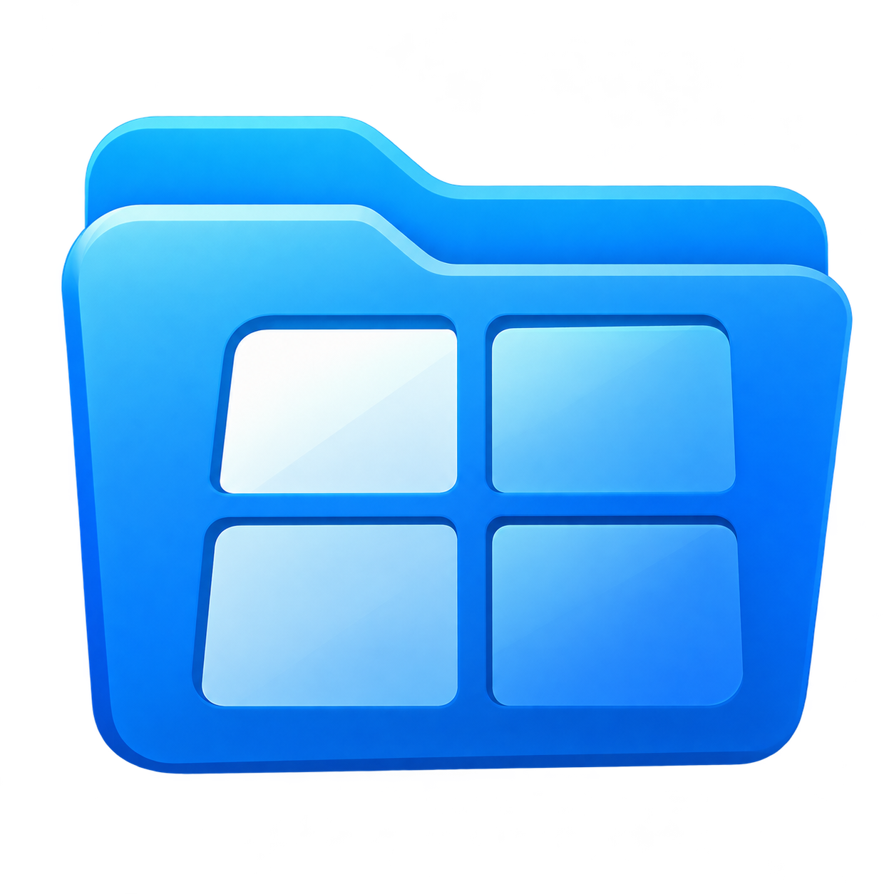

<div align="center">



# Folder Splitter for Mac

**윈도우 하나에 폴더 최대 네 개, 영역마다 따로 있는 탭. 이름 일부만 입력해도 찾습니다.**

[English](README.md) · **한국어**

</div>

[Folder Splitter](../README.ko.md)를 macOS용으로 새로 만든 네이티브 앱(Swift + AppKit)입니다. 매일 쓰는 Finder를 대신하도록 만들었고, Finder와 함께 실행되며 Finder를 수정하지 않습니다.

## 주요 기능

| 기능 | 설명 |
|---|---|
| **영역 4개, 영역마다 탭** | 영역 1~4개(⌥⌘1~⌥⌘4, 위아래·세로 3열 배치 포함). 영역마다 탭과 방문 기록이 따로 있습니다. 탭을 다른 영역으로 끌거나 영역 가장자리에 놓아 분할합니다. 영역 수를 줄여도 가려진 영역의 탭은 남아 있습니다. |
| **주소 막대가 곧 검색** | 이름 일부(`report 2026`)나 경로 조각(`15min_rain/rn_15m`)을 입력하면 입력하는 대로 파일과 폴더가 나타나고, 열어 둔 위치에 가까운 항목이 먼저 나옵니다. 앱이 직접 파일 이름 색인을 만들고(파일 내용은 읽지 않음) FSEvents로 갱신합니다. 한글 이름은 macOS가 저장한 방식(NFC/NFD)과 관계없이 찾습니다. |
| **Finder 수준의 파일 목록** | 폴더를 펼치는 목록 보기, 썸네일 아이콘 보기, 폴더별 보기·정렬 기억, 훑어보기(스페이스 바), 이름 변경, 태그, 다음으로 열기, 공유, 서비스, Finder와 같은 복사/이동 규칙의 드래그 앤 드롭, 스프링 로드 폴더. |
| **클라우드 동기화 상태** | Finder처럼 이름 옆에 상태 아이콘: Dropbox 항목의 최신 상태·온라인 전용(크기는 —)·무시됨, iCloud Drive와 클라우드 저장소 항목의 다운로드되지 않음·다운로드 중·업로드 중·충돌. '지금 다운로드'와 '다운로드 제거'를 지원합니다. 온라인 전용 Dropbox 파일은 Dropbox가 내려받은 뒤 열립니다. |
| **실행 취소되는 파일 작업** | 진행률과 이름 충돌 선택(모두 유지, 대치 — 대치된 항목은 휴지통으로, 건너뛰기, 정지, 모두에 적용)이 있는 복사·이동. ⌘Z로 이동, 복사, 이름 변경, 새로운 폴더, 복제, 휴지통으로 이동을 되돌립니다. 다른 디스크로 옮길 때는 끝까지 복사된 항목만 원본에서 지웁니다. Dropbox 온라인 전용 파일은 빈 파일이 되지 않도록 복사·다른 디스크로 이동·Dropbox 밖으로 이동·복제·압축하지 않고 이유를 알립니다. 작업 중에 종료하려 하면 먼저 묻습니다. |
| **영역 사이 작업** | 선택 항목을 다른 영역으로 복사·이동(⌃⌥C / ⌃⌥X), 이 폴더를 다른 영역에서 열기(⌃⌥O), 두 폴더 비교 후 다른 항목 선택. |
| **미리보기와 정보 가져오기** | 세부 정보(크기, 재생 시간, 페이지)가 있는 미리보기, 고정, 별도 미리보기 윈도우, 폴더 크기·기본 앱·잠금 등을 보여 주는 정보 윈도우. |
| **여러 항목 이름 변경** | 찾기/바꾸기(정규 표현식 가능)와 일련번호 `{n}` / `{n:3}`, 실시간 미리보기. 실행 취소 한 번으로 전체를 되돌립니다. |
| **이어서 작업** | 윈도우, 영역, 탭, 방문 기록, 배치를 다음 실행 때 복원합니다. 이름 붙인 작업 구성을 저장합니다. 닫은 탭과 영역은 ⇧⌘T로 다시 엽니다. |
| **macOS가 허용하는 범위에서 Finder 대체** | 기본 파일 뷰어로 지정하면 다른 앱의 'Finder에서 보기'와 폴더 열기가 Folder Splitter로 열립니다. 전역 단축키 ⌃⌥⌘F로 어디서든 앞으로 가져옵니다. 서비스 ▸ 'Folder Splitter에서 열기'. |

라이트/다크 모드, 동작 줄이기, 투명도 줄이기, 대비 증가 설정을 따릅니다. 한국어와 영어를 지원합니다.

## 요구 사항

- macOS 15 Sequoia 이상, Apple 실리콘 또는 Intel
- 빌드: Xcode Command Line Tools(Swift 6.1). Xcode는 필요하지 않습니다.

## 설치

1. [최신 Mac 릴리스](https://github.com/HSoo-Kim/folder-splitter/releases)에서 `folder-splitter-mac.zip`을 내려받아 압축을 풀고, **Folder Splitter**를 **응용 프로그램** 폴더로 옮깁니다. 다운로드 폴더에서 바로 열면 업데이트가 설치되지 않습니다.
2. Folder Splitter를 두 번 클릭합니다. Apple 공증을 받지 않은 앱이라 '‘Folder Splitter’을(를) 열지 않음' 경고가 뜹니다. **완료**를 누릅니다(**휴지통으로 이동**이 아님).
3. 시스템 설정 ▸ 개인정보 보호 및 보안을 열고 아래쪽 '보안'에서 'Mac을 보호하기 위해 ‘Folder Splitter’을(를) 차단했습니다.' 옆의 **그래도 열기**를 누른 뒤 암호를 입력합니다. 이 버튼은 2번을 한 뒤 한 시간 동안만 보입니다.
4. 다시 뜨는 확인 창에서 **그래도 열기**를 누릅니다. 이후에는 그냥 열립니다.

**전체 디스크 접근 권한**(권장): 시스템 설정 ▸ 개인정보 보호 및 보안 ▸ 전체 디스크 접근 권한에서 Folder Splitter를 켭니다(목록에 없으면 **+**로 응용 프로그램 폴더의 Folder Splitter를 추가). Folder Splitter 설정 ▸ 일반에서도 상태를 보고 이 화면을 열 수 있습니다. 켠 뒤에는 Folder Splitter를 종료하고 다시 엽니다. 이 권한이 없으면 macOS가 데스크탑, 문서, 다운로드 폴더 접근을 따로 묻고, 허용하지 않은 폴더는 검색되지 않습니다. 업데이트해도 허용한 권한은 유지됩니다.

### 직접 빌드하기

```sh
git clone https://github.com/HSoo-Kim/folder-splitter.git
cd folder-splitter/mac
scripts/install.sh        # 릴리스 빌드 후 /Applications/Folder Splitter.app 에 설치하고 실행
```

배포용 zip은 `scripts/package.sh`로 만듭니다(`build/folder-splitter-mac.zip`, Apple 실리콘·Intel 공용). 릴리스는 고정 서명 인증서(`scripts/make-signing-identity.sh`로 한 번 만듦)로 서명해야 사용자가 업데이트해도 macOS 권한이 유지됩니다. 공증은 받지 않습니다.

## Finder 대신 쓰기

설정 ▸ 일반 ▸ **기본 파일 뷰어로 사용**을 켜면 두 가지가 Folder Splitter로 열립니다. 다른 앱의 'Finder에서 보기'(`NSFileViewer`)와 폴더 열기(터미널의 `open <폴더>`, 다른 앱에서 연 폴더; `public.folder` 기본 뷰어)입니다. 데스크탑과 Dock의 폴더는 계속 Finder가 열고, Finder도 계속 실행됩니다. 끄면 Finder로 돌아갑니다. Folder Splitter를 지우기 전에 이 설정을 끄십시오. 이미 지웠다면 터미널에서 `defaults delete -g NSFileViewer`를 실행합니다.

자동화: `open "foldersplitter://open?path=/Users/me/Projects&in=tab"` (`in` = `current`, `tab`, `other`, `right`, `below`, `window`), `foldersplitter://reveal?path=…`

## 키보드 단축키

Finder 단축키는 Finder와 같습니다(⌘N, ⌘T, ⌘W, ⇧⌘N, ⌘D, ⌘I, ⌘⌫, ⌘[, ⌘], ⌘↑, ⌘↓, ⇧⌘G, ⇧⌘., ⌘1, ⌘2, 스페이스 바, Return …). 추가된 단축키:

| 키 | 동작 |
|---|---|
| ⌥⌘1 – ⌥⌘4 | 영역 1~4개 |
| ⌃1 – ⌃4 | 영역 1~4로 이동 |
| ⌥⌘] / ⌥⌘[ 또는 F6 / ⇧F6 | 다음 / 이전 영역 |
| ⌃⇥ / ⌃⇧⇥ | 다음 / 이전 탭 보기 |
| ⇧⌘T | 마지막으로 닫은 탭 또는 영역 다시 열기 |
| ⌘L | 이름으로 파일 검색(주소 막대) |
| ⌘F | 이 폴더 필터 |
| ⌃⌥C / ⌃⌥X | 선택 항목을 다른 영역으로 복사 / 이동 |
| ⌃⌥O | 다른 영역에서 이 폴더 열기 |
| ⌥⌘C | 경로 이름 복사 |
| ⌥⌘V | 항목을 여기로 이동 |
| ⇧⌘P | 미리보기 보기/가리기 |
| ⌘+ / ⌘- | 텍스트 크게 / 작게 |
| ⌃⌥⌘F | 어느 앱에서든 Folder Splitter를 앞으로(설정에서 변경) |
| ⌘? | 모든 단축키 |

## 업데이트

Windows 앱처럼 윈도우 맨 아래 줄 왼쪽에 버전, 오른쪽에 만든 사람이 보입니다. 새로운 Mac 릴리스가 있으면 '새로운 버전 … 사용 가능 · 업데이트'가 함께 보이고, 알림에서 **업데이트** 또는 **나중에**를 고를 수 있습니다. 업데이트를 누르면 `folder-splitter-mac.zip`을 받아 GitHub가 알려 주는 SHA-256과 대조한 뒤 앱을 바꾸고 다시 엽니다. 검사에 하나라도 실패하면 아무것도 바뀌지 않습니다. 지금 위치에서 앱을 바꿀 수 없으면 릴리스 페이지를 엽니다. 앱 메뉴 ▸ 업데이트 확인…으로 바로 확인할 수 있습니다.

Mac 릴리스 올리는 법:

1. `mac/VERSION`을 올리고(예: `0.1.2`) 커밋합니다.
2. `mac/scripts/package.sh`를 실행합니다 → `mac/build/folder-splitter-mac.zip`
3. GitHub ▸ Releases ▸ Draft a new release에서 태그 `mac-v0.1.2`을 만들고 `folder-splitter-mac.zip`을 첨부한 뒤, **"Set as the latest release" 체크를 끕니다.** Windows 앱은 최신(latest) 릴리스만 읽으므로 Mac 전용 릴리스가 그 자리를 차지하면 안 됩니다. Publish를 누릅니다.
4. 최상위 README 4개의 Mac 다운로드 링크를 새 태그로 바꾸고 커밋합니다:
   `sed -i '' -E 's#(download|tag)/mac-v[0-9.]+#\1/mac-v0.1.2#g' ../README*.md`

Windows와 함께 내는 릴리스(태그 `vX.Y.Z`에 `folder-splitter-win-x64.zip`과 `folder-splitter-mac.zip`을 모두 첨부)도 Mac 버전이 `X.Y.Z`이면 됩니다.

## 데이터

- 세션과 설정: `~/Library/Application Support/Folder Splitter/session.json` (직전 버전은 `session.json.bak`)
- 검색 색인: `~/Library/Application Support/Folder Splitter/Search/paths.v1.index`
- 색인하지 않는 곳(폴더 자체는 이름으로 찾을 수 있음): `/System`, `/Library`, `/private`, `/usr`, `/opt`, `/Volumes`, `~/Library`(iCloud Drive와 `~/Library/CloudStorage`의 Dropbox·Google Drive·OneDrive 등 클라우드 폴더는 색인함; 클라우드에만 있는 폴더를 내려받지는 않음), `~/.Trash`, `~/.dropbox`, `.git`·`node_modules` 내용, 패키지(`.app` 등) 내용, 설정 ▸ 검색에서 제외한 폴더
- 네트워크: 업데이트 확인만 합니다. 실행할 때, 1시간마다, 15분 이상 지나 앱으로 돌아올 때 `api.github.com`에서 릴리스 정보만 읽습니다(조건부 요청이라 바뀌지 않은 응답은 공용 요청 한도를 쓰지 않습니다). 사용자·기기·파일 정보는 보내지 않습니다. 설정 ▸ 일반에서 끌 수 있습니다.

## 개발

```text
Sources/Shared/   Foundation 전용 계약: 설정, 모델, 경로 해석, 포맷
Sources/Core/     검색 엔진, 세션·배치 모델, 파일 작업 엔진(AppKit 없음)
Sources/App/      AppKit: Main(윈도우, 영역, 메뉴, 세션, QA 하네스), Chrome(탭, 주소 막대,
                  도킹 오버레이), FileList, Sidebar, Preview, FileOperations,
                  Models(시트), Settings, System(단축키, 기본 뷰어)
Tests/            Swift Testing 테스트
scripts/          build, test, typecheck, qa, install, package
```

SwiftPM은 쓰지 않습니다. 일부 Command Line Tools 설치본은 `PackageDescription` 파일이 서로 맞지 않아서, 스크립트가 `swiftc`를 직접 호출합니다(`scripts/env.sh`는 `import AppKit`을 깨뜨리는 오래된 `module.modulemap`도 우회합니다).

```sh
scripts/build.sh [--debug]     # build/Folder Splitter.app (릴리스는 Apple 실리콘·Intel 공용)
scripts/test.sh                # 단위 테스트(검색, 모델, 파일 작업, 미리보기 메타데이터)
scripts/package.sh             # build/folder-splitter-mac.zip (공용): 다른 Mac 배포·릴리스용
scripts/qa.sh [--lang en|ko] [--arch x86_64] [--onscreen]
                               # 실제 앱을 키보드·마우스 이벤트, Apple Event, 윈도우 캡처로
                               # 끝까지 검증. 별도 번들 ID로 실행해 설치된 앱에 영향을 주지 않음.
                               # 윈도우는 화면 밖에 두고 앱은 포커스를 가져가지 않음(--onscreen:
                               # 화면에서 보기, 표 더블클릭과 macOS 오류 알림 UI 확인).
                               # 결과와 스크린숏은 build/qa/<언어>/
scripts/desktop-check.sh [--lang ko|en]
                               # 같은 방식으로, 밖에서 agent-desktop(npm i -g agent-desktop)이
                               # 손쉬운 사용으로 조작·확인: 테스트 폴더와 ~/Dropbox(읽기만)의
                               # Dropbox 상태
```

## 라이선스

[MIT](../LICENSE)
