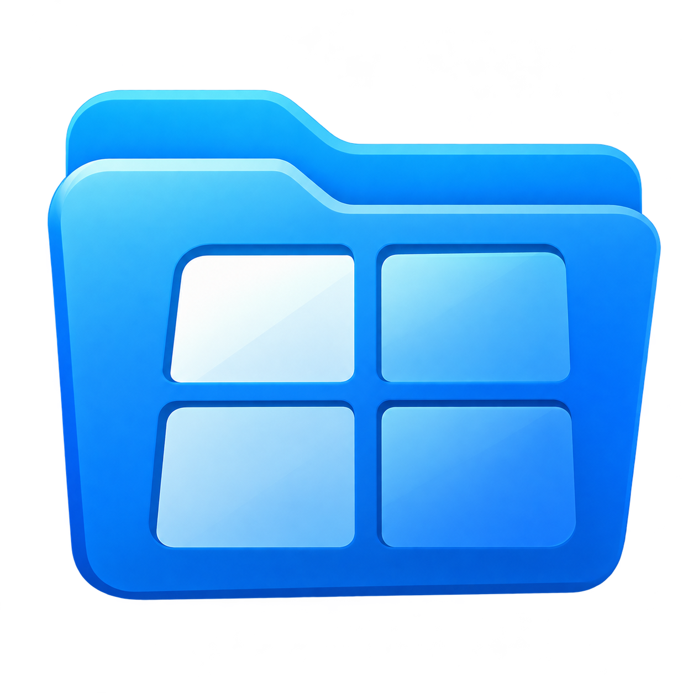

<div align="center">



# Folder Splitter for Mac

**Up to four folders in one window, each pane with its own tabs. Find anything by typing a fragment.**

**English** · [한국어](README.ko.md)

</div>

A native macOS (Swift + AppKit) version of [Folder Splitter](../README.md) built to stand in for Finder in daily work. It runs alongside Finder and doesn't modify it.

## Highlights

| Feature | What it does |
|---|---|
| **Four panes, independent tabs** | 1–4 panes (⌥⌘1–⌥⌘4, plus stacked and three-column layouts). Every pane has its own tabs and history. Drag a tab to another pane, or to a pane's edge to split it. Hidden panes keep their tabs when you switch to fewer panes. |
| **The address bar is a search box** | Type part of a name (`report 2026`) or a path fragment (`15min_rain/rn_15m`) and matching files and folders appear as you type, ranked by nearness to what you have open. The app keeps its own file-name index (no file contents are read) and updates it with FSEvents. Korean names match regardless of how macOS stored them (NFC/NFD). |
| **Finder-grade file list** | List view with expandable folders, icon view with thumbnails, per-folder view and sort memory, Quick Look (Space), inline rename, tags, Open With, Share, Services, drag and drop with Finder's copy/move rules, spring-loaded folders. |
| **Cloud sync status** | Like Finder, a status icon by each name: Dropbox items up to date, online-only (size shows —) or ignored, and iCloud Drive / cloud-storage items not downloaded, downloading, uploading or in conflict, with Download Now and Remove Download. Online-only Dropbox files open through Dropbox, which downloads them first. |
| **File operations you can undo** | Copy/move with progress and name-conflict choices (Keep Both, Replace — the replaced item goes to the Trash, Skip, Stop, apply to all). ⌘Z undoes moves, copies, renames, new folders, duplicates and Move to Trash. |
| **Between panes** | Copy or move the selection to the other pane (⌃⌥C / ⌃⌥X), open this folder in the other pane (⌃⌥O), compare the two folders and select what differs. |
| **Preview and Get Info** | Inline Quick Look preview with details (dimensions, duration, pages), pin, detached preview windows, and a Get Info window with folder sizes, default app and flags. |
| **Batch rename** | Find and replace (or regular expressions) with a running number `{n}` / `{n:3}` and a live preview; one undo reverts the batch. |
| **Pick up where you left off** | Windows, panes, tabs, history and layout restore on launch. Save named workspaces. Closed tabs and panes reopen with ⇧⌘T. |
| **Replaces Finder where macOS allows** | Optional default file viewer: "Show in Finder" from other apps and opened folders go to Folder Splitter. Global shortcut ⌃⌥⌘F brings it to the front. Services ▸ "Open in Folder Splitter". |

Light and dark appearance, Reduce Motion, Reduce Transparency and Increase Contrast are respected. Interface in English and Korean.

## Requirements

- macOS 15 Sequoia or later, Apple silicon or Intel
- To build: Xcode Command Line Tools (Swift 6.1). Xcode itself isn't needed.

## Install

```sh
git clone <this repository> folder-splitter-mac
cd folder-splitter-mac
scripts/install.sh        # builds a release app, installs /Applications/Folder Splitter.app, launches it
```

To hand the app to someone else, `scripts/package.sh` makes `build/folder-splitter-mac.zip` (universal). They unzip it and move **Folder Splitter** to Applications. The build is signed ad hoc and not notarized, so the first launch is blocked: after the warning, open System Settings ▸ Privacy & Security, click **Open Anyway** next to "Folder Splitter was blocked", and confirm.

On first launch macOS may ask for access to Desktop, Documents and Downloads; granting **Full Disk Access** (Settings ▸ General) avoids the per-folder prompts and lets search cover protected folders.

## Using it as a Finder replacement

Settings ▸ General ▸ **Use as default file viewer** makes Folder Splitter the system's file viewer in two ways: "Show in Finder" / "Reveal in Finder" from other apps opens it (`NSFileViewer`), and so does opening a folder (`open <folder>` in Terminal, folders opened from other apps; the default viewer for `public.folder`). The Desktop and folders in the Dock still belong to Finder, and Finder keeps running. Turn the setting off to restore Finder.

Automation: `open "foldersplitter://open?path=/Users/me/Projects&in=tab"` (`in` = `current`, `tab`, `other`, `right`, `below`, `window`) and `foldersplitter://reveal?path=…`.

## Keyboard shortcuts

Finder's shortcuts work as in Finder (⌘N, ⌘T, ⌘W, ⇧⌘N, ⌘D, ⌘I, ⌘⌫, ⌘[, ⌘], ⌘↑, ⌘↓, ⇧⌘G, ⇧⌘., ⌘1, ⌘2, Space, Return …). Additions:

| Key | Action |
|---|---|
| ⌥⌘1 – ⌥⌘4 | 1–4 panes |
| ⌃1 – ⌃4 | Go to pane 1–4 |
| ⌥⌘] / ⌥⌘[ or F6 / ⇧F6 | Next / previous pane |
| ⌃⇥ / ⌃⇧⇥ | Next / previous tab |
| ⇧⌘T | Reopen the last closed tab or pane |
| ⌘L | Search files by name (address bar) |
| ⌘F | Filter the current folder |
| ⌃⌥C / ⌃⌥X | Copy / move the selection to the other pane |
| ⌃⌥O | Open this folder in the other pane |
| ⌥⌘C | Copy path |
| ⌥⌘V | Move item here |
| ⇧⌘P | Preview pane |
| ⌘+ / ⌘- | Text size |
| ⌃⌥⌘F | Bring Folder Splitter to the front from any app (configurable) |
| ⌘? | All shortcuts |

## Updates

The bottom line of the window shows the version on the left and the author on the right, as in the Windows app. When a newer Mac release exists, it also shows "New version … available · Update" and a notice offers **Update** or **Later**. Update downloads `folder-splitter-mac.zip`, checks it against the SHA-256 GitHub reports for the asset, replaces the app and reopens it; if any check fails nothing changes. If the app can't be replaced where it is, the release page opens instead. App ▸ Check for Updates… checks right away.

Publishing a Mac release:

1. Raise `mac/VERSION` (for example `0.1.2`) and commit.
2. Run `mac/scripts/package.sh` → `mac/build/folder-splitter-mac.zip`.
3. On GitHub ▸ Releases ▸ Draft a new release, create the tag `mac-v0.1.2`, attach `folder-splitter-mac.zip`, and **uncheck "Set as the latest release"** — the Windows app reads only the latest release, so a Mac-only release must not take that spot. Publish.
4. Point the Mac download links in the four top-level READMEs at the new tag, then commit:
   `sed -i '' -E 's#(download|tag)/mac-v[0-9.]+#\1/mac-v0.1.2#g' ../README*.md`

A combined release (tag `vX.Y.Z` with both `folder-splitter-win-x64.zip` and `folder-splitter-mac.zip`) works too, as long as the Mac version is `X.Y.Z`.

## Data

- Session and settings: `~/Library/Application Support/Folder Splitter/session.json` (previous version kept as `session.json.bak`)
- Search index: `~/Library/Application Support/Folder Splitter/Search/paths.v1.index`
- Not indexed (the folders themselves are still found by name): `/System`, `/Library`, `/private`, `/usr`, `/opt`, `/Volumes`, `~/Library`, `~/.Trash`, `.git` and `node_modules` contents, package contents (`.app` …), plus folders you exclude in Settings ▸ Search.
- Network: only the update check. At launch, every hour, and when the app comes back after 15 minutes or more, it reads release information from `api.github.com` (conditional requests, so unchanged answers don't use the shared rate limit). No user, machine or file information is sent. Turn it off in Settings ▸ General.

## Development

```text
Sources/Shared/   Foundation-only contracts: settings, models, path parsing, formatting
Sources/Core/     Search engine, session/layout models, file-operation engine (no AppKit)
Sources/App/      AppKit: Main (window, panes, menus, session, QA harness), Chrome (tabs,
                  address bar, dock overlay), FileList, Sidebar, Preview, FileOperations,
                  Models (sheets), Settings, System (hotkey, default viewer)
Tests/            Swift Testing suites
scripts/          build, test, typecheck, qa, install, package
```

SwiftPM isn't used: some Command Line Tools installs ship mismatched `PackageDescription` files, so the scripts call `swiftc` directly (`scripts/env.sh` also works around a stale `module.modulemap` that breaks `import AppKit`).

```sh
scripts/build.sh [--debug]     # build/Folder Splitter.app (release builds are universal)
scripts/test.sh                # unit tests (search, models, file operations, preview metadata)
scripts/package.sh             # build/folder-splitter-mac.zip (universal) for other Macs and releases
scripts/qa.sh [--lang en|ko] [--arch x86_64] [--onscreen]
                               # end-to-end QA: drives the real app with keyboard and mouse
                               # events, Apple Events and window captures, as a separate
                               # bundle ID so an installed copy is never touched. Windows stay
                               # off screen and the app never takes focus (--onscreen to watch,
                               # and to check table double-clicks, which need an active app);
                               # report and screenshots in build/qa/<lang>/
scripts/desktop-check.sh [--lang ko|en]
                               # the same hands-off way, driven from outside through
                               # accessibility with agent-desktop (npm i -g agent-desktop):
                               # Dropbox status on a fixture and, read-only, on ~/Dropbox
```

## License

[MIT](../LICENSE)
